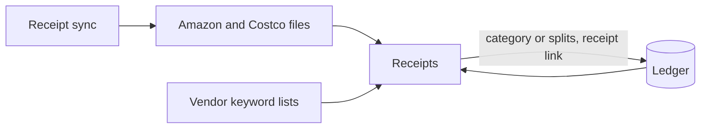
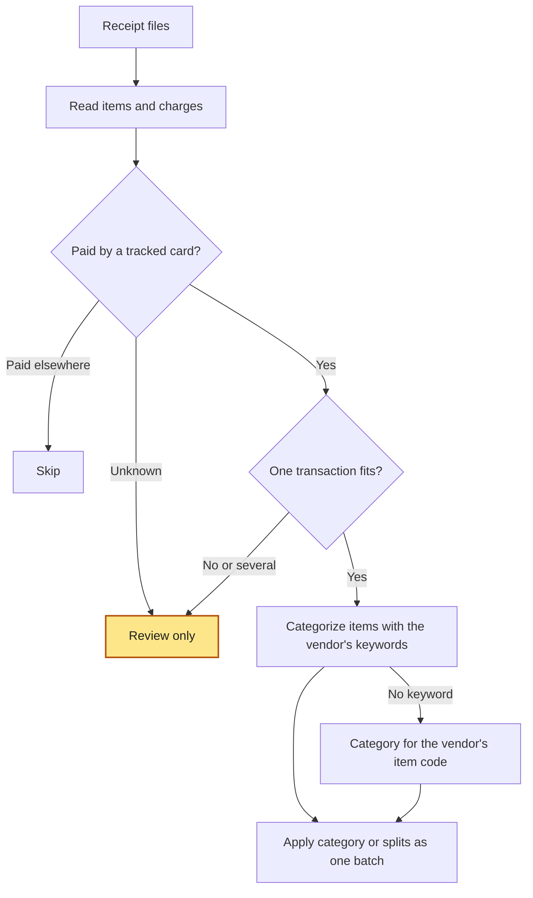

# Receipts

## Purpose

A receipt says what a purchase or refund contained. omsync uses Amazon and Costco receipts to split
a charge into categories. A receipt never creates money.

## Context

## Flow

## Design decisions

- **A receipt applies only to one matching transaction.** Amount, sign, payee, card, and date window
  must match exactly one transaction. If more than one matches, the receipt waits for review.
- **A receipt with an unknown card does not apply automatically.** Amount and date cannot show that
  the purchase is yours.
- **You add each card number to its account.** omsync does not add a number from matches, because
  a match is evidence, not proof.
- **The period limits what applies, not the evidence.** A shorter period cannot make an ambiguous
  match unique.
- **Amazon orders come only from the files that a sync saves.** Each file gives the card charges
  of the order. omsync does not read the Amazon data export. See
  [ADR 0003](../adr/0003-read-amazon-orders-from-the-payment-history.md).
- **Amazon: when no transaction has a stated charge, the order total must equal one exact set of
  transactions.** A first-fit guess can take a different purchase.
- **Amazon: a charge with no card was paid by gift card or points.** It is an offset of
  the card charge, so the items keep their full price. An order paid only by gift card or points
  has no card charge.
- **Costco: a reward or a shop card is a line of the split.** The items keep their full price. A
  keyword gives the line its category. omsync does not guess it.
- **An item with no keyword takes the category of its item code, when you choose one.** Costco
  marks food with a code. A keyword always wins over an item code.
- **Each vendor is one entry in a list.** The entry gives its payee wording and its item codes.
  Matching, keyword lists, and the Categories page read the list. They do not name a vendor.
- **Costco uses your signed-in browser.** omsync does not use a vault login for Costco.

## Terms

- **Charge:** the amount of a receipt that one transaction on one account paid.
- **Receipt match:** the link from a charge to its transaction.
- **Vendor login:** one sign-in's receipts at a vendor. It is a receipt provider (see
  [sync](sync.md)).
- **Item code:** a vendor's own class for an item, such as Costco's food code.

See [get receipts](../how-to/get-receipts.md) for the steps.
