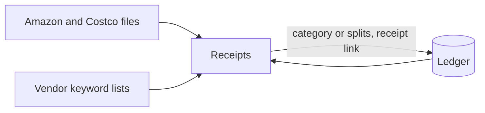
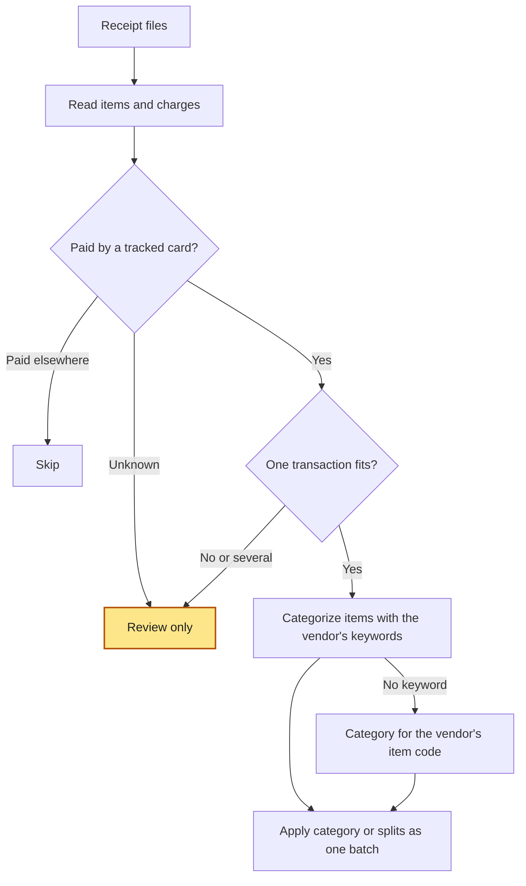

# Receipts

## Purpose

A receipt says what a purchase or refund contained. omsync uses Amazon and Costco receipts to split
a charge into categories. A receipt never creates money.

## Context

## Flow

## Design decisions

- **A receipt applies only to one matching transaction.** Amount, sign, payee, card, and date window
  must match exactly one transaction. If more than one matches, the receipt waits for review.
- **A receipt with an unknown card does not apply automatically.** Amount and date cannot show that
  the purchase is yours.
- **A card matches an account by any of its numbers.** One account can pay with several numbers,
  such as a phone wallet's number. You add each number to the account. omsync does not add one
  from matches, because a match is evidence, not proof.
- **The period limits what applies, not the evidence.** A shorter period cannot make an ambiguous
  match unique.
- **Amazon: an order total must equal one exact set of charges.** A first-fit guess can take a
  different purchase. An order with a gift card waits for review, because Amazon does not show the
  gift card amount.
- **Costco: each line that is not a product goes into the products.** A discount goes into the item
  it names, also when it has no tax flag. A price adjustment takes the name of its item on an
  earlier receipt. A credit that names no item is shared across the items by amount. Thus a
  discount, a void, or a coupon on a return does not stop a split.
- **Costco: a card number of zeros is an unknown card.** Costco prints zeros on some returns. These
  returns wait for review.
- **Costco: a payment that is not your card is a line of the split.** A reward or a shop card can
  pay part of a receipt. The items then keep their full price, and the other payment is a line
  with the opposite sign, so the lines add up to what your card paid. The keyword list gives that
  line its category, for example a reward as income and a shop card as a transfer. omsync does not
  guess it.
- **Costco: a food item with no keyword takes the food category.** Costco marks food on its
  receipts. You choose the category on the Costco keyword list. A keyword always wins over the mark,
  so a food item can still go to another category. Only food is marked, so other items need
  keywords.
- **Costco uses your signed-in browser.** omsync does not use a vault login for Costco.

## Terms

- **Charge:** the amount of a receipt that one transaction on one account paid.
- **Receipt match:** the link from a charge to its transaction.
- **Vendor login:** one sign-in's receipts at a vendor.

See [get receipts](../how-to/get-receipts.md) for the steps.
