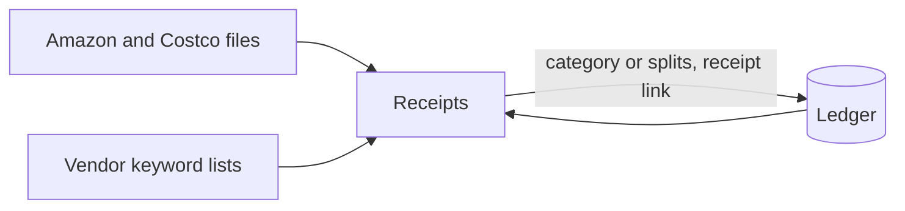
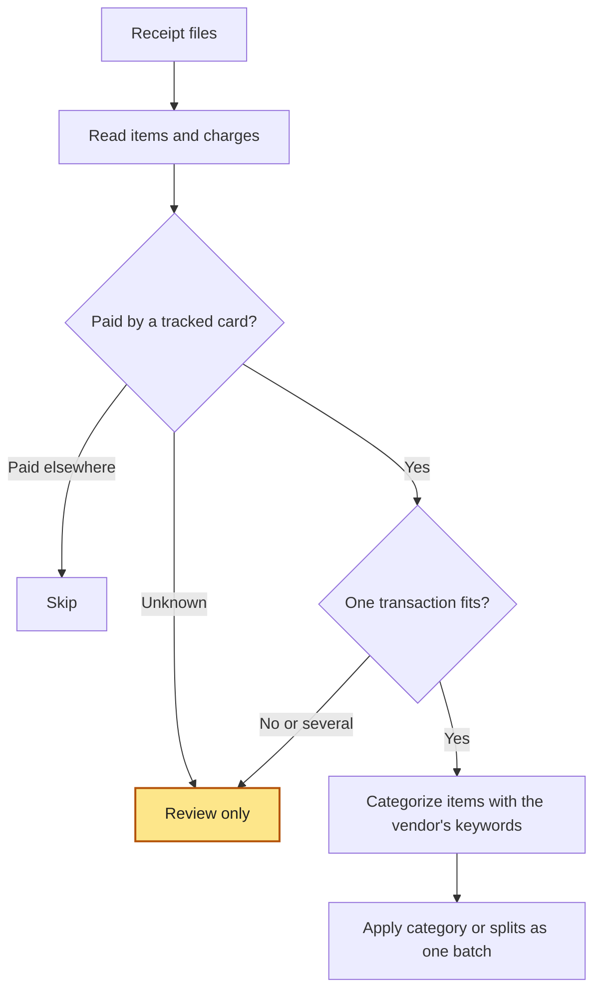

# Receipts

## Purpose

A receipt says what a purchase or refund contained. omsync uses Amazon and Costco receipts to split
a charge into categories. A receipt never creates money.

## Context

## Flow

## Design decisions

- **A receipt applies only to one matching transaction.** Amount, sign, payee, card, and date window
  must match exactly one transaction. If more than one matches, the receipt waits for review.
- **A receipt with an unknown card does not apply automatically.** Amount and date cannot show that
  the purchase is yours.
- **The period limits what applies, not the evidence.** A shorter period cannot make an ambiguous
  match unique.
- **Amazon: an order total must equal one exact set of charges.** A first-fit guess can take a
  different purchase. An order with a gift card waits for review, because Amazon does not show the
  gift card amount.
- **Costco uses your signed-in browser.** omsync does not use a vault login for Costco.

## Terms

- **Charge:** the amount of a receipt that one transaction on one account paid.
- **Receipt match:** the link from a charge to its transaction.
- **Vendor login:** one sign-in's receipts at a vendor.

See [get receipts](../how-to/get-receipts.md) for the steps.
