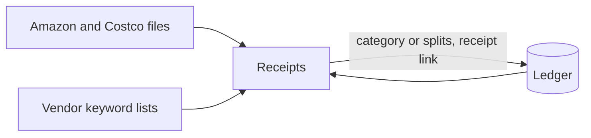
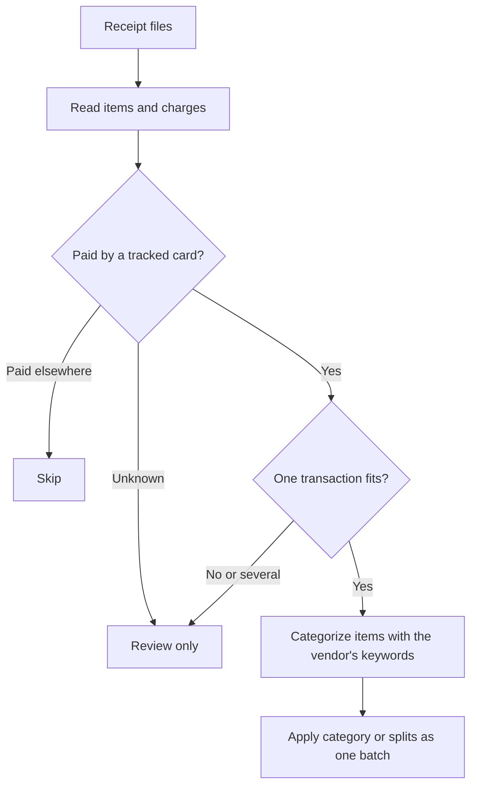

# Receipts

## Purpose

A receipt says what a purchase or refund contained. omsync uses Amazon and Costco receipts to split
a charge into categories. A receipt never creates money.

## Context

## Flow

## Design decisions

- **Apply only a unique match.** Amount, sign, payee, card, and date window must fit one
  transaction. A tie stays in review.
- **An unknown card never applies automatically.** Amount and date cannot prove that a purchase
  is yours.
- **Your category wins.** A receipt never replaces a category or split that you set.
- **A changed receipt goes to review.** It never applies twice. A new ship date alone is not a
  change.
- **The period limits what applies, not what counts as evidence.** A shorter period cannot make an
  ambiguous match unique.
- **Amazon: an order total needs an exact, unique set of charges.** A first-fit guess could take an
  unrelated purchase.
- **Amazon: a gift card goes to review.** Amazon does not say how much the gift card paid.
- **Costco: each card payment is a charge.** With several cards, each charge gets its share of
  the categories.
- **Costco uses your signed-in browser.** omsync does not use vault logins for Costco.

## Terms

- **Charge:** the part of a receipt paid as one transaction on one account.
- **Receipt match:** the link from a charge to its transaction.
- **Vendor login:** one sign-in's receipts at a vendor.

See [sync and receipts](../how-to/sync-and-receipts.md) for the steps.
