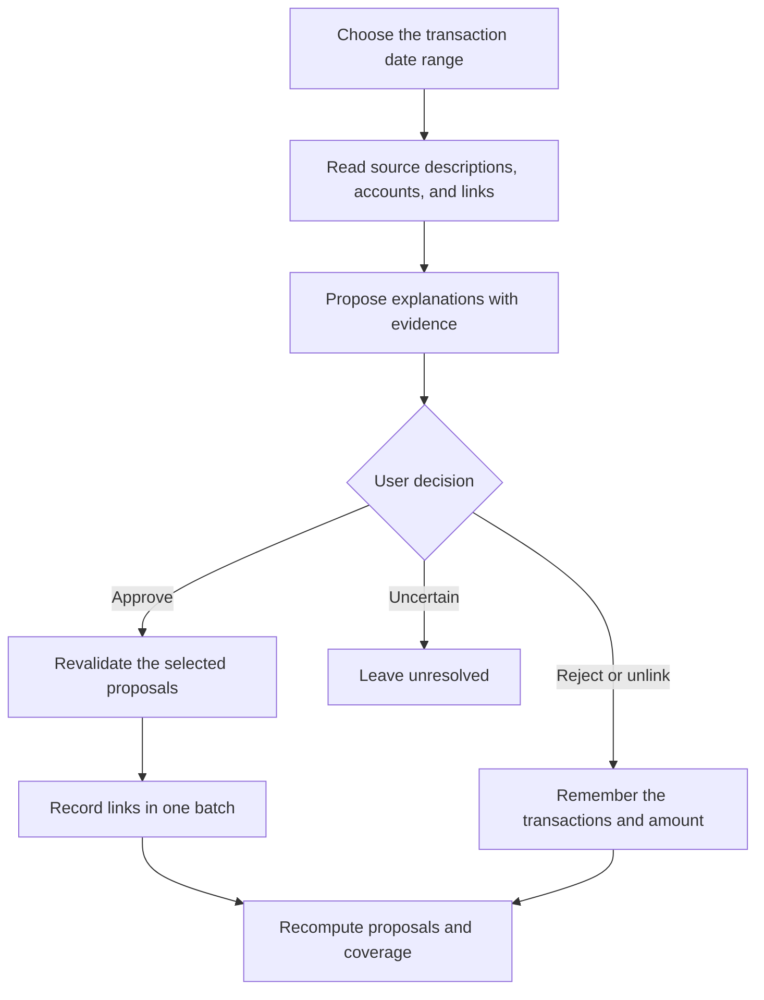
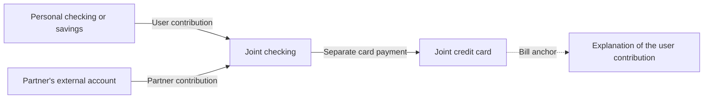

# Reconciliation

## Purpose and design philosophy

Reconciliation proposes relationships explaining transactions. A false link can hide real
spending or misrepresent a reimbursement, so a false positive costs more than a missed
proposal. Equal amounts are evidence, not proof of a relationship.

A **proposal** is a typed link waiting for a decision, with confidence and evidence. A
**transfer** moves money between tracked accounts. A **P2P payment** involves another person,
whose other account is not in this ledger. A **counterparty** is a saved person or business
with text identifying expected payments. A **joint settlement** is the user's contribution
to a joint card bill, not the bill payment itself. A transaction is **not matched** when it should
have a counterpart and nothing accounts for it; see
[Not matched and acknowledgments](#not-matched-and-acknowledgments).

## Behavior and flow

A run reads a date range and writes nothing. It presents transfers, refunds, P2P payments,
and joint settlements in confidence-based queues. The automatic queue holds exact,
unambiguous matches, so the user is not asked about them. After every [import](import.md) and
[sync](sync.md), omsync [categorizes](categories.md) with the keywords, because the return rules
skip transfers, loans, and investments by category, then runs reconciliation over the whole
history and applies every automatic-queue proposal as one batch, labelled as automatic, that undo
reverses like any other. If categorizing fails, nothing is applied. Nothing is applied when there
is nothing to apply. The review and manual queues are never applied
without the user's action: the user can approve, reject, link manually, unlink, or leave such a
proposal unresolved. The Reconcile page can still approve the automatic proposals that appear
between imports, such as after data is edited.

Specific relationships are considered before broad similarity, so a joint contribution
cannot be taken by a generic reimbursement rule. A run has deterministic ordering and
reserves proposed explanations without changing ledger data. Fully explained transactions
do not become new candidates; partial links leave an unexplained remainder. Evidence such
as a bill anchor can remain useful even after that transaction has been linked.

Rule text is the statement row's description, read through the same function import uses
(NAME, with MEMO joined only for institutions whose format continues NAME there), never
Transaction.memo. Chase can place confirmation evidence in MEMO alone, and a NAME cut at its
length limit continues in MEMO without a space, so identifiers and account references can be
glued to the words around them. Reimbursement scoring can additionally use the user's
explanatory memo as a distinct signal.

Evidence shows confirmation identifiers, signs, date gaps, amount differences, account
references, and existing links. An account reference is a description naming the last four
digits of an account, by a mask (`...1111`, `########4321`), an account word (`ACCT# 2222`,
`CHK 3333`), or “to”/“from” followed by the account's name. The digits may be the account's
number or the statement ID its bank shows now. Only “to” and “from” are directional: a
sender's “to” names the destination and a receiver's “from” names the source, and agreement
or contradiction is shown to the reviewer. A reference to another tracked account is also a
transfer signal. It proposes a transfer when that account holds the one equal and opposite
amount within four days, unique from both sides, and no side names a different tracked account
than its partner's. The reference replaces a confirmation number as the signal, never the
amount, date, or uniqueness conditions.

## Transfer and refund rationale

A transfer needs a transfer signal as well as compatible signs, amount, account roles, and
posting times. A retail debit must not become a card payment merely because its amount fits.
“Payment” inside a Zelle description is not by itself a credit-card bill payment.

Posting gaps reflect the mechanism: confirmation-based account transfers, same-day Zelle,
card payments, and card credit-balance refunds have different expected timing. A card autopay
can post on the card on a Friday or Saturday and at the bank on Monday, so card payments allow
five days. A shared confirmation does not waive sign, amount, or account checks. Uniqueness
must hold from both sides; multiple fitting partners require a manual decision.

Banks that give the two sides of one transfer different wordings often print the same long
identifier on both. A number of ten or more digits, or a Zelle confirmation token, held by
exactly two transactions is a **shared ID**. Two transactions on different accounts with a
shared ID, equal and opposite amounts, at most three days apart, are an automatic transfer.
Ten digits keep dates, last fours, and nine-digit routing numbers from being IDs. An ID held by
three or more transactions decides nothing, and neither does a transaction whose two IDs lead to
different partners. Amazon and Costco transactions are left to [receipts](receipts.md).
The ID resolves several same-day transfers of one amount that no amount rule could separate.
Existing confirmation rules stay for their forms and windows; the shared-ID rule runs after them.

Card payments recognize the issuers' current wordings on both sides, including scheduled-payment
and “payment from checking” forms. The same card-credit wordings anchor joint settlements.
Where a wording is ambiguous, an account reference can still resolve the pair.

Refunds can return to the purchase account or another account. Exact source evidence is
stronger than brand similarity. Generic PayPal transfer text identifies a mechanism, not
a merchant. Amazon and Costco purchase/refund explanations belong to
[receipts](receipts.md), so generic return rules do not compete for their transactions.
When an allowed cent difference exists, the link explains only the smaller amount and
leaves the remainder visible.

## P2P rationale

A P2P inflow can reimburse spending, repay a loan, contribute to shared finances, or be
unrelated income. General proposals use earlier spending, compatible amounts, and explanatory
text; confidence ranks evidence rather than certifying who paid whom. Several plausible
debits remain a manual decision. An inflow without a debit is not proposed: a payment from a
person has no second side to link, and no fictitious one is invented. It is listed as not matched.

A reimbursement is scored by what the text says it was for. Merchant and spending words match
whole words only, so “rei” is not found in “reimbursement”. The service's own name (Zelle,
PayPal, Venmo) and other words every payment shares are not evidence that two transactions
are related. A debit that moves money between the user's own accounts is not a purchase: a
transfer or card-payment wording, a Zelle payment to one of the user's own names, or a
description naming another tracked account never becomes the debit a reimbursement repays.
A cash-out from a P2P service is an inflow like any other P2P credit.

Saved counterparties provide separate outgoing and incoming patterns, at least one pattern in
all. Patterns must be valid and cannot match empty text. These proposals receive review because a
recognizable person and a matching amount still require interpretation. The user's own saved names are
literal alternatives for recognizing their transfers, not hard-coded identities.

## Not matched and acknowledgments

A transaction is **expected to have a counterpart** when its description, read as rules read it,
is one half of a pair. For money out: a transfer wording, a card-payment wording, a credit-balance
refund, a Zelle payment to one of the user's own names, or a description that names another
tracked account by its last four digits. For money in: a Zelle, Venmo, or PayPal payment from
someone (including a cash-out); a card-payment credit; a transfer wording; or a description that
names another tracked account. A purchase, and a payment to someone else, are not expected to pair.

A transaction is **not matched** when it is expected to have a counterpart, links do not cover
all of it, no proposal of the run involves it, and nothing below explains it. The run exposes
the list, so the Reconcile page and the Home attention count cannot disagree. Rejecting a proposal
leaves its transactions not matched. What the user is asked to resolve is the review and manual
proposals plus the not-matched list: automatic proposals are applied without the user, and
explained transactions need nothing.

An **acknowledgment** says the user expects no counterpart. It is a decision about one
transaction, with an optional note, stored through [batches](changes.md) so undo reverses it. It
creates no link and covers none of the amount, so it never changes what is reconciled, which
stays derived from links alone, and it never changes a proposal or the automatic step. A
transaction links fully cannot be acknowledged. A **counterparty acknowledgment** is the standing
form: a saved counterparty marked as one whose payments are not expected to match covers every
transaction whose description matches that counterparty's patterns on the side its sign names,
now and when later imported. It is reviewed and removed where counterparties are managed, and
from the Explained group; marking a counterparty does not stop its patterns from proposing.
Marking from a transaction requires that counterparty's patterns to match that transaction.

**Explained** transactions are those that would be not matched, with the reason: the
acknowledgment or counterparty, a partner contribution that a joint settlement accounts for, or a
forward. Explained is collapsed on the page, and each acknowledgment can be removed there.
A transaction's own acknowledgment is shown in preference to any other reason.

A **forwarded payment** is the user's dominant reimbursement flow. A friend pays a personal
account by Zelle, Venmo, or PayPal, and within seven days the user sends the identical amount on to
a joint account. The outflow is a transfer, so its link already uses its amount: the inflow
cannot be linked to it too. A P2P inflow with no link and no proposal is explained as forwarded
when exactly one chain of outflows exists: on the inflow's account, identical amount, posted from
the inflow's day to seven days later, each being the sending side of a transfer or a joint
settlement (an existing link, or an automatic proposal of the same run) whose other side has the
identical amount in the same window. The chain may pass through further own accounts and must
end on a joint account. It is computed on every run and stored nowhere, so removing the
forward's link returns the inflow to not matched. Words the two descriptions share are shown as
evidence and never required, because a cash-out carries none.

Ambiguity is never resolved by guessing. With more than one possible chain, the inflow stays not
matched and a hint names them. One outflow explains at most one inflow: when another unlinked P2P
inflow could use any outflow of the chain, neither is explained and each hint names the other.
A purchase proposal for the inflow still appears as usual, and then forwarding does not apply.
A forward that has neither a link nor an automatic proposal within the seven days after the
range ends is not seen until the range includes it.

## Joint settlement rationale

The bill anchor is a payment credit on a joint credit card. It explains why the user sends
half the bill from personal checking or savings to joint checking. The link pairs that
personal debit and joint-checking credit. The card payment is evidence, not a third side
of the settlement link.

A contribution fits a bill when it is half the bill to within one cent. When the user's payment
description names the joint card, by the account's name or the last four digits of its number,
the payment selects that card's bills by itself and may be within one dollar of half, which
covers a bill that does not split evenly. The joint inflow must then match the payment to the
cent, so the pair explains what was actually sent. Partner contributions use the same slack.
Without a named card the one-cent fit is kept, and a payment that names one joint card is never
matched to another's bill.

Compatible contributions belong to their nearest fitting bill, so equal bills in different
months do not compete indiscriminately. Confirmation evidence narrows the user's joint
inflow but does not bypass amount or date checks. A missing inflow remains a one-sided
manual proposal rather than a fabricated pair.

A **partner contribution** has no visible debit in this ledger. It is labeled, never linked.
One unambiguous partner inflow can receive an explanatory memo on approval, only if its memo
is empty. Several candidates are shown without guessing which one deserves the label.
They are kept out of generic P2P proposals. Approved settlement evidence preserves this
exclusion on reruns; a bill remains an anchor even after its own card-payment link is approved.
Undo removes the settlement's effects, allowing the evidence to be considered again.

## Decisions and reruns

Approval refuses a proposal that is no longer current. Selected proposals cannot reuse the
same transaction. Manual links require opposite signs and an amount fitting both available
remainders. Receipt links are created by receipt application, not the manual-link dialog.

Rejection remembers the transaction set and amount independently of link kind. A pair
rejected as a transfer must not return as a P2P explanation; a genuinely different one-sided
proposal remains a different decision. Rejections are excluded before candidate selection
so they do not manufacture ambiguity or consume a better proposal.

Unlinking a link remembers its pair the same way, in the same batch, so undoing the unlink also
forgets it. A removed or rejected pair is never proposed or applied again, which is what makes
automatic application safe to leave on: the next import cannot recreate a link the user removed.
Each remembered pair also keeps the rule that proposed or made it, the evidence, and whether it
was rejected or unlinked. Removing a receipt link records nothing, since receipts are matched by
their own application. Undoing an automatic batch is not a rejection: its proposals return, and
the next import applies them again unless the user unlinks them individually.

A rule is only as trusted as the user's experience of it. A rule with two unlinked links stops
applying automatically: its automatic proposals move to the review queue, with a note saying why,
and stay there. Rejected proposals do not count, because rejecting says a proposal was wrong
before it did harm, while unlinking says an applied link was. The page tallies, for each rule,
the links in place, the links unlinked, and the proposals rejected.

Approval (including the automatic batch), rejection, manual linking, unlinking, and
acknowledgments use [batches](changes.md). An automatic apply is atomic, stale-aware, and revalidated as an approval
is, and a failure of the automatic step never undoes the import before it: the proposals stay
available on the Reconcile page. Reconciled
state is derived from link coverage. Approving some proposals and rerunning must neither
reuse their money nor hide evidence required to resolve what remains.
