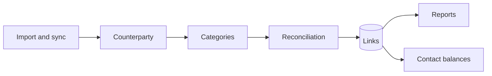
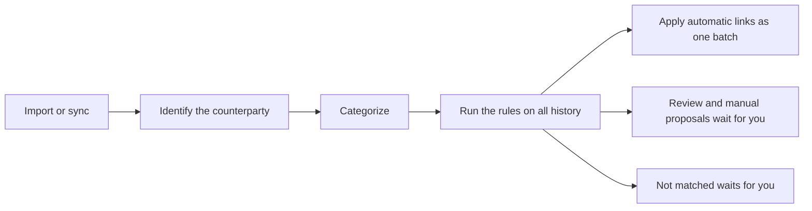
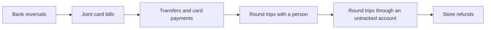
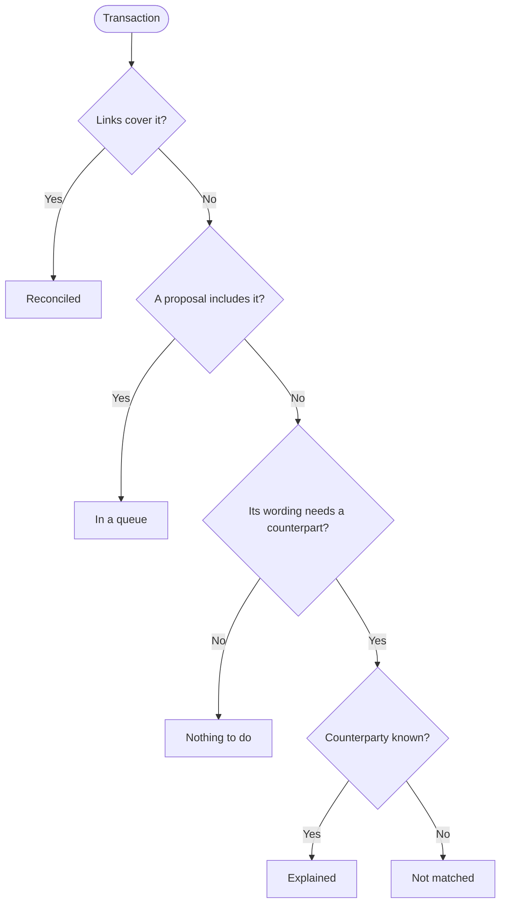
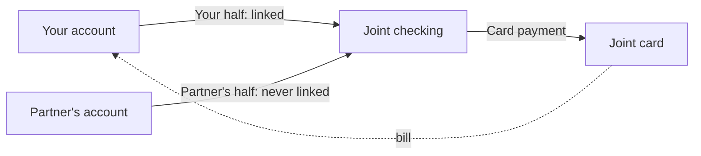

# Reconciliation

## Purpose

Reconciliation links each transaction to its counterpart: the other half of a transfer, a card
payment, a refund, or a joint bill. A linked transfer is not spending or income.

## Context

## Flow

### Each run

The rules read the counterparty and the category, so those two steps run first.

### Rule order

Specific rules run first. Each rule takes its transactions out of the pool for the next rules.

A reversal runs first because the original also reads as a transfer. A joint bill runs before
transfers so a generic rule cannot take your half of the bill.

### What each transaction becomes

### Joint card bills

You and your partner each pay half of a joint card bill into joint checking. The card payment is
evidence, not a side of the link.

## Design decisions

- **A wrong link costs more than a missed link.** A wrong link can hide real spending. An equal
  amount is evidence, not proof.
- **Unique from both sides.** A match is automatic only when each side has one possible partner.
  Two partners make a manual proposal.
- **Interchangeable partners are not a choice.** Payments with the same accounts and amount can
  pair in any order. The nearest pairs link first.
- **Automatic links apply after each import.** Review and manual proposals never apply without
  you.
- **A removed link stays removed.** omsync remembers each pair that you unlink or reject. It never
  proposes that pair again. This makes automatic links safe.
- **omsync does not guess what a payment from a person repaid.** The category says how the
  payment counts. Only a round trip (money out and back from one person) links.
- **Venmo and PayPal never need a counterpart.** Their statements are not imported, and the sender
  writes free text.
- **Rules read the bank's text, never your memo.**

## Terms

- **Counterpart:** the other half of a pair, such as the arriving side of a transfer.
- **Counterparty:** who the money moved with. See [contacts](contacts.md).
- **Proposal:** a link that waits for a decision.
- **Automatic, review, manual:** the three queues. Automatic applies alone. Review needs a yes or
  no. Manual needs you to pick between candidates.
- **Not matched:** needs a counterpart, has no link, and its counterparty is unknown.
- **Explained:** needs a counterpart, but its counterparty is known, so no link is needed.
