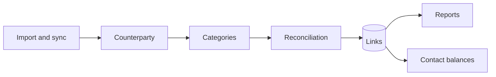
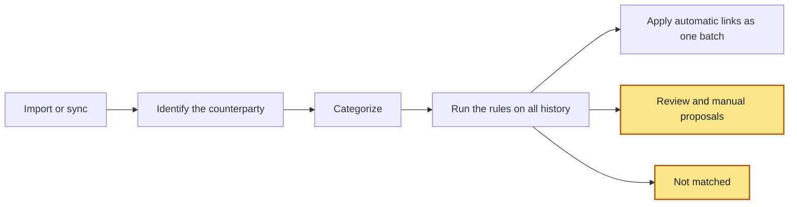
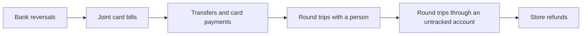
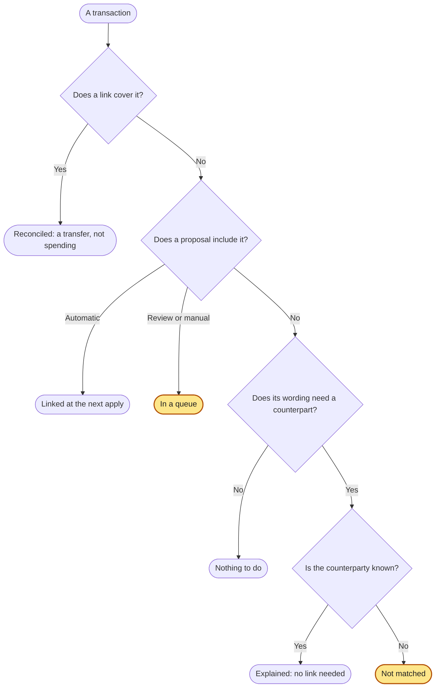
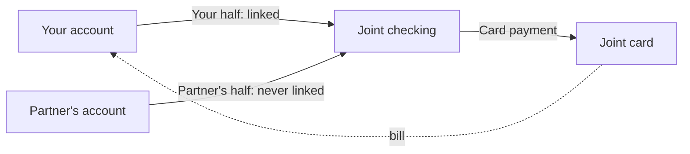

# Reconciliation

## Purpose

Reconciliation links each transaction to its counterpart: the other half of a transfer, a card
payment, a refund, or a joint bill. A linked transfer is not spending or income.

## Context

## Flow

### Each run

The rules read the counterparty and the category, so those two steps run first.

### Rule order

Specific rules run first. Each rule takes its transactions out of the pool for the next rules.

A reversal runs first because the original also reads as a transfer. A joint bill runs before
transfers so a generic rule cannot take your half of the bill.

### What each transaction becomes

### Joint card bills

You and the co-owner each pay half of a joint card bill into joint checking. The card payment is
evidence, not a side of the link.

## Design decisions

- **A link applies automatically only when each side has one possible partner.** An incorrect link
  can hide real spending, so an equal amount is not enough. With two possible partners, omsync makes
  a proposal for review.
- **A removed link stays removed.** omsync records each pair that you unlink or reject, and does not
  propose it again.
- **Only a round trip links to a person.** That means money out to a person and back from the same
  person. The category tells what any other payment from a person repaid.

## Terms

- **Counterpart:** the other half of a pair, such as the arriving side of a transfer.
- **Counterparty:** who the money moved with. See [contacts](contacts.md).
- **Proposal:** a link that waits for a decision.
- **Automatic, review, manual:** the three queues. Automatic applies alone. Review needs a yes or
  no. Manual needs you to pick between candidates.
- **Not matched:** needs a counterpart, has no link, and its counterparty is unknown.
- **Explained:** needs a counterpart, but its counterparty is known, so no link is needed.
