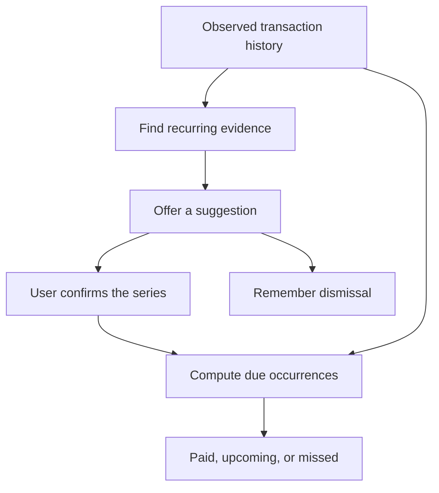

# Recurring series

## Purpose and design philosophy

Recurring activity makes future cash flow easier to anticipate. Detection offers patterns
for the user to confirm; it does not manufacture future ledger transactions. Sure inspires
the calendar and upcoming-series presentation.

A **recurring series** is repeated activity on a schedule, such as a bill, subscription, or
paycheck. Series decisions are suggested, confirmed, or dismissed. A dated occurrence is
paid, upcoming, or missed according to observed transactions and its payment window.

## Behavior

Detection groups compatible payees, signs, amounts, accounts, and date intervals. It looks
for enough distinct observations to establish a cadence from weekly through yearly. Noise
and reference numbers should not split one recurring payee into unrelated groups.

Repeated observations across accounts close in time are considered together to avoid
counting both sides of the same activity as independent repetition. Amount bands can
separate a stable recurring charge from unrelated purchases at the same payee. Variable
amounts require stronger regularity rather than being accepted merely because the payee
repeats. A series that stops appearing loses evidential strength.

The user confirms a suggestion, chooses its name, category, and amount tolerance, or
dismisses it. Dismissal remains effective for compatible later observations instead of
returning on every small price change. Restoring a dismissed series permits reconsideration;
deleting it forgets the decision. Suggestions are revalidated when confirmed.

Schedule refresh uses matching posted transactions through today to determine last activity
and next due date. Monthly dates retain their anchor across short months: a series anchored
on the 31st can fall on February's last day and return to the 31st in March. A qualifying
transaction within the occurrence window makes it paid; an unpaid occurrence becomes missed
only when that window closes.

## Flow

The page offers upcoming activity, a monthly calendar, all series, and dismissed history.
Monthly summaries distinguish expected inflows and outflows from posted amounts and
unpaid occurrences. Series detail shows its schedule and recent supporting transactions
and links back to the register.

Confirming, dismissing, restoring, editing, and deleting use [batches](changes.md).
Refreshing changed series records their changes through the same mechanism. The series'
sign remains stable: editing a bill's name or tolerance does not turn it into income.

## Design rationale

A repeated payee is insufficient evidence by itself. Cadence, amount consistency, and
continued observations reduce false suggestions while still supporting variable bills.
Persisting dismissal respects the user's knowledge rather than repeatedly asking the same
question.

Upcoming occurrences are expectations, not posted money. Keeping them outside the ledger
preserves the meaning of statements, report totals, and balance checks.
