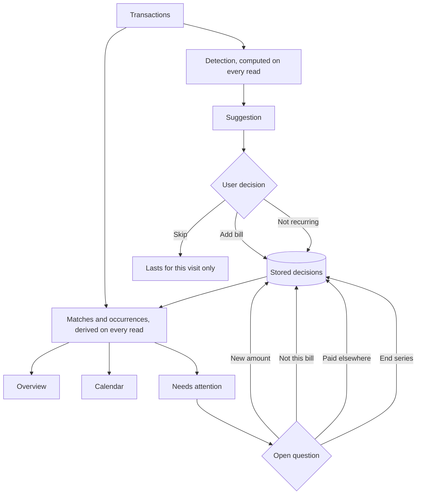

# Recurring series

## Purpose and design philosophy

Recurring series make future cash flow easier to anticipate. The page answers two questions:
what is due, and what is wrong. Setup work stays out of the way, so the page opens on those
answers. Sure inspires the layout.

A **recurring series** is repeated activity on a schedule, such as a bill, subscription, or
paycheck. The interface calls an outflow a bill and an inflow income. A dated instance of a
series is an occurrence. It is paid, upcoming (shown as "Due"), or missed.

The page must never say something false about money. A false Missed, or a false bill counted
in a total, is worse than a missing one. Anything uncertain is shown as a question, never as
a state.

The ledger is the truth, and recurring is a reading of it. Only the user's decisions are
stored. Everything else is derived from transactions on every read, so an import, an undo, or
an edit cannot leave the page out of step with the ledger. Detection never writes.

Each question is asked once. Every answer is stored, and the same question is not asked again.

The user confirms every series. Detection only suggests.

## Behavior

### Detection

Detection groups compatible payees, signs, amounts, accounts, and date intervals. It looks
for enough distinct observations to establish a cadence from weekly through yearly. Noise
and reference numbers should not split one recurring payee into unrelated groups.

Repeated observations across accounts close in time are considered together, so that both
sides of the same activity do not count as independent repetition. Amount bands separate a
stable recurring charge from unrelated purchases at the same payee. Variable amounts need
stronger regularity rather than being accepted merely because the payee repeats. A series
that stops appearing loses evidential strength.

Detection writes nothing. Its output is a suggestion, computed on every read and named by its
payee pattern, account, cadence, and typical amount. A suggestion is revalidated when the
user acts on it. Only confirmed series appear in totals or produce occurrences.

### Decisions

The user confirms a suggestion, dismisses it, or skips it. Confirming is one action. It keeps
the detected name, category, and tolerance, and the user edits them afterwards. Dismissal stays
effective for compatible later observations, so a small price change does not bring a
dismissed series back. Restoring a dismissed series removes the dismissal, so detection may
suggest it again. Deleting a series forgets the decision together with its amount history,
rejections, and paid-elsewhere marks.

The user can end a series, for example when it is cancelled or stopped. An ended series
produces no further occurrences, and detection does not suggest its pattern again. A later
matching charge raises a question in Needs attention rather than reviving the series. Resuming
an ended series makes it active again.

### Series settings

A confirmed series has a name, category, cadence, payee pattern, account, and amount tolerance.
Its sign does not change when the name or tolerance is edited.

The amount is shown as Fixed or Varies. Fixed uses a small automatic margin, the larger of $1
and 3%. Varies uses the band observed in history. Both are the one tolerance, and the exact
numbers sit under Advanced.

The amount is stored with the date it took effect. A later price change adds an entry and
never rewrites earlier months, so the amount in effect on a date is the latest entry on or
before it.

### Matching

A charge matches a series when its payee fits the pattern, its sign and account match, its
amount is within tolerance of the amount in effect on its date, and it posts within the
cadence window of a due date. A rejected charge never matches.

When two charges could pay the same due date, that is a question in Needs attention. The page
does not choose one silently.

Last seen and next due are derived from the matching posted transactions through today. Monthly
dates retain their anchor across short months: a series anchored
on the 31st can fall on February's last day and return to the 31st in March.

### Price changes

A charge from the series' payee within the window whose amount falls outside the band still
counts the occurrence as paid, flagged "New amount?", when it is the only such charge in the window
and between half and double the amount in effect. A payee can also sell unrelated things, so any
other out-of-band charge leaves the due date unpaid. The user either accepts the new amount,
which takes effect from that charge's date, or says "Not this bill", which stores a rejection
of that charge. The amount never changes by itself, and an occurrence never shows Missed for
this reason. After "Not this bill", the occurrence is judged without that charge: if no other
charge pays the due date and its window closes, it is missed, unless the user marks it paid
elsewhere.

### Paid elsewhere

A bill can be paid from an account omsync does not track. For such a bill the user marks one
due date paid elsewhere. The mark covers that due date only and needs no ledger charge.

### Occurrence states

An occurrence is paid when a qualifying charge falls within its window, or when it is marked
paid elsewhere. An occurrence that is not yet due is upcoming. It becomes missed only when its
window closes with no charge and no paid-elsewhere mark.

### Transfers

A series whose category reports leave out, such as an excluded transfer like card autopay or an
owed loan payment, is listed and labeled "Not in totals". Its occurrences are paid, upcoming, or missed like any other, but it stays out
of bill totals, so money is not counted twice.

### Interface

The page has three views: Overview, Calendar, and All bills. An Income plan view, showing what
is due before each payday, is planned for when income series are confirmed.

Overview, top to bottom:

- This month's totals: Left to pay, with a count of the outflows still due; Paid; and Income
  expected.
- A one-line prompt when suggestions exist: "N possible bills found. Not counted yet." with a
  Review action.
- Needs attention: missed occurrences this month and the open questions above. Hidden when
  empty.
- This month, in date order, with paid occurrences in place.
- Next month, with one row per series.

Review shows one suggestion at a time, in a drawer. The drawer shows the name, amount, cadence,
and the last four charges as evidence. Its actions are Add bill, Not recurring, and Skip. Skip
lasts only for that visit.

Calendar shows the month grid.

All bills lists confirmed series sorted by monthly-equivalent cost. A non-monthly cadence shows
an approximate monthly figure, and the page shows monthly and yearly totals. A status filter
also shows Dismissed series, which offer Restore, and Ended series, which offer Resume.

The series drawer shows the schedule, amount history, and matched charges with a link to the
register. Its actions are Edit, End (or Resume for an ended series), and Delete; opened from an
unpaid due date, it also offers Paid elsewhere. Editing chooses Fixed or Varies; an amount already
changed by accepted new amounts is not edited there.

A bill can be added by hand, or started from a transaction in the register, where the user
picks the cadence.

Every write on this page is a [batch](changes.md). The toast after a change offers Undo, which
replaces a separate history list.

## Flow

## Design rationale

Only decisions are stored because a stored suggestion or match would go stale as soon as the
ledger changed. Detection writes nothing, so undo has only the user's own decisions to reverse,
and the page cannot drift from the ledger.

A repeated payee is insufficient evidence by itself. Cadence, amount consistency, and continued
observations reduce false suggestions while still supporting variable bills.

Amounts carry an effective date because a price change must not turn past months into Missed.
A new amount is a fact from the date of the charge that shows it, forward.

A price change is a question because a false Missed is the most confusing thing the page can
say, and an automatic change to the amount could be wrong. Only the user knows whether a new
charge is the same bill at a new price.

The user confirms every series because a false bill distorts totals more than a missing one
costs. A missing suggestion costs one look at Review. A false bill inflates Left to pay until
someone notices.

Transfers stay out of totals because card autopay moves money that the card's own purchases
already count. Counting both would count the same money twice.

Each answer is stored so the user is not asked the same question again. Persisting dismissal
and rejection respects the user's knowledge rather than repeatedly asking.

Upcoming occurrences are expectations, not posted money. Keeping them outside the ledger
preserves the meaning of statements, report totals, and balance checks.
