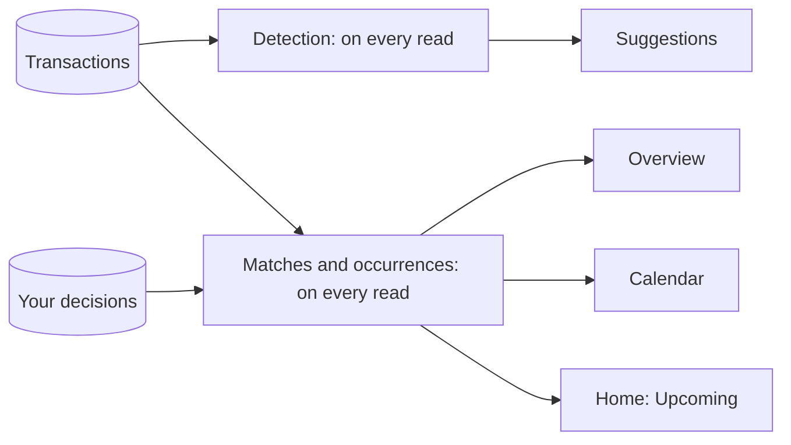
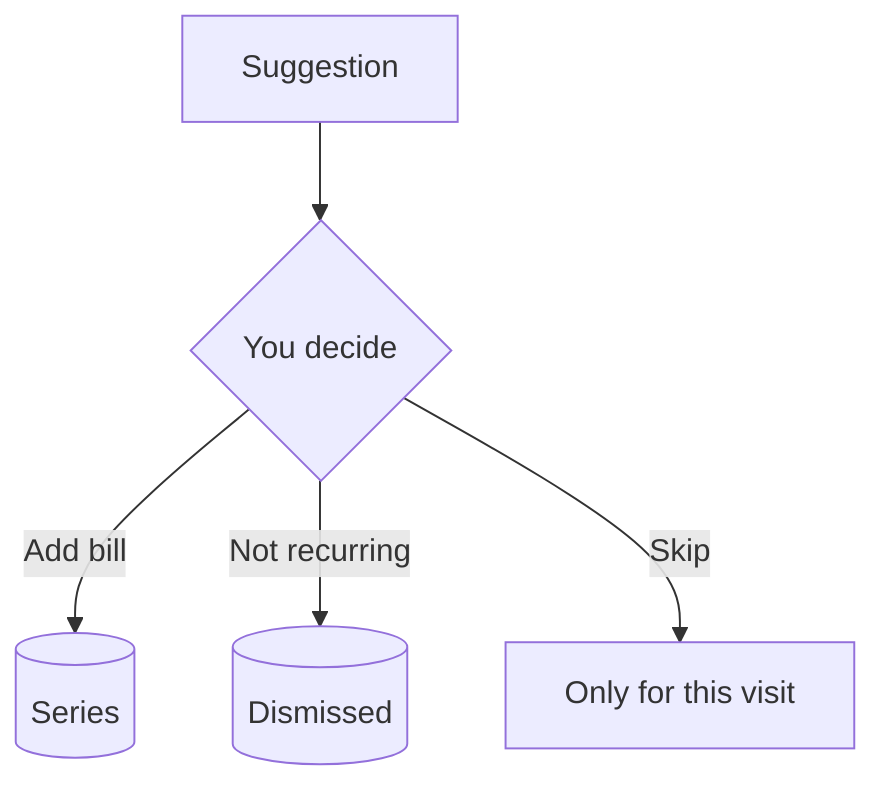
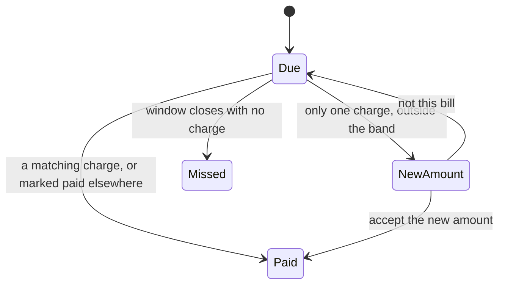

# Recurring series

## Purpose

Recurring shows what is due and what is wrong: bills, subscriptions, and paychecks on a schedule.

## Context

## Flow

### Suggestion to series

### One occurrence

## Design decisions

- **Never say something false about money.** A false Missed or a false bill is worse than a
  missing one. Doubt becomes a question, never a state.
- **Store only your decisions.** omsync derives everything else from the ledger on each read. An
  import, undo, or edit cannot leave the page out of step.
- **You confirm every series.** Detection only suggests. A false bill would inflate Left to pay.
- **Ask each question once.** omsync stores each answer.
- **An amount has an effective date.** A price change never turns past months into Missed.
- **A price change is a question.** Only you know if it is the same bill at a new price.
- **Transfers are not in totals.** A card autopay moves money that the card's purchases already
  count.
- **Upcoming is not ledger money.** It never changes reports or balances.

## Terms

- **Series:** a confirmed repeated bill or income.
- **Occurrence:** one due date of a series: paid, due, or missed.
- **Paid elsewhere:** a due date paid from an account omsync does not track.
