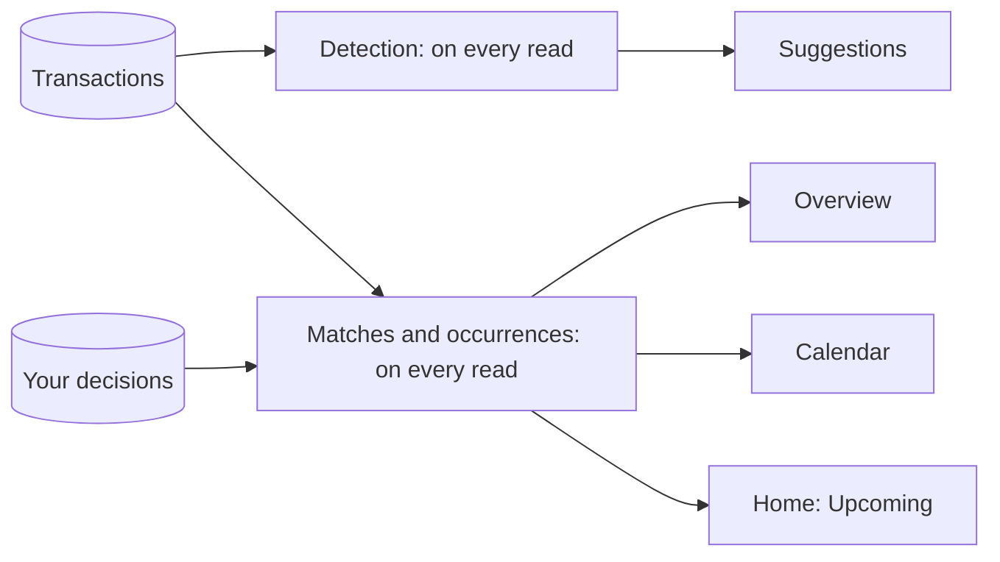
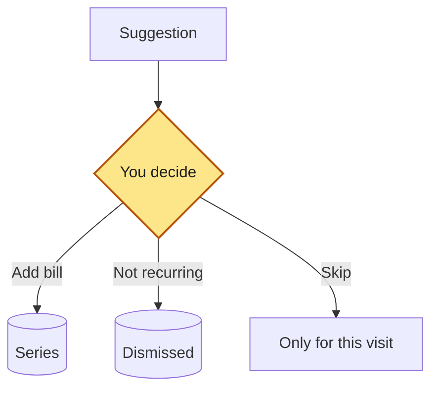
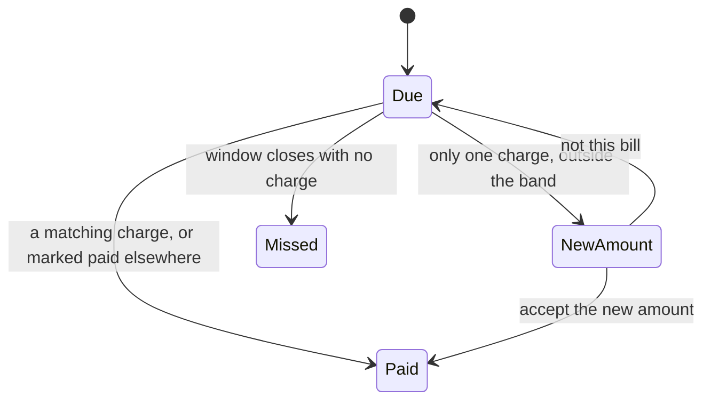

# Recurring series

## Purpose

Recurring tracks bills, subscriptions, and paychecks that repeat on a schedule. It shows what is
due, paid, or missed.

## Context

## Flow

### Suggestion to series

### One occurrence

## Design decisions

- **The Overview shows this month and next month side by side.** You compare what is left now with
  what comes next, so both stay in view, and each list scrolls on its own. Possible bills wait
  behind Review, at the top of every view, because they count only after you confirm them.
- **Detection only suggests a series. You confirm it.** An uncertain charge, such as a new price,
  becomes a question, not a Missed state.
- **omsync stores only your decisions.** It calculates everything else from the ledger at each
  read, so the page stays correct after an import, an undo, or an edit.
- **An amount has an effective date.** A price change does not make past months Missed.
- **Totals leave out transfers.** A card autopay moves money that the card purchases already count.

## Terms

- **Series:** a confirmed repeated bill or income.
- **Occurrence:** one due date of a series: paid, due, or missed.
- **Paid elsewhere:** a due date paid from an account omsync does not track.
