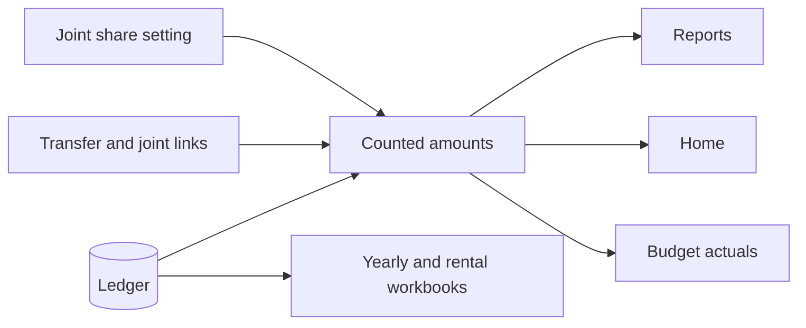
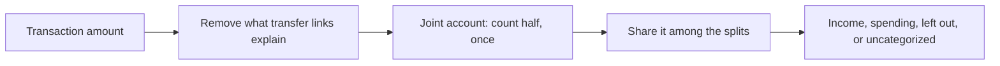

# Reports and exports

## Purpose

Reports define what counts as income and spending, once. Home, budgets, and exports use the same
numbers, so two views never disagree.

## Context

## Flow

### Counted amount of one transaction

## Design decisions

- **A link removes only the amount that it explains.** A $100 payment with a $40 transfer link
  counts as $60 of spending.
- **Refund and P2P links remove no amount.** The category tells how the money counts.
- **A refund decreases spending.** A positive amount in a spending category decreases that category.
- **Exports show full amounts.** They mark joint-account activity. omsync does not add full amounts
  and counted amounts together.

## Terms

- **Counted amount:** what a report counts for a transaction or split.
- **Joint share:** count joint-account money at half. It is on by default.
- **Rental workbook:** income, expenses, and net for each rental property.
