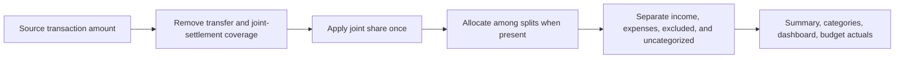

# Reports and exports

## Purpose and design philosophy

Every financial view must agree on what counts. Reports define counted amounts once; the
dashboard, budget actuals, and exports use that interpretation instead of accumulating
similar-but-different formulas. Sure inspires the period-oriented summary and drill-down.

## Counted amounts

A report counts a transaction's splits when present, otherwise the transaction itself.
It never counts both parent and parts.

Transfer and joint-settlement links exclude the amounts they explain, not necessarily the
whole transaction. A $100 outflow with $40 explained by such a link still contributes $60.
Refund, P2P, and receipt links do not exclude amounts merely because they exist.

Lines in an excluded category are excluded. Uncategorized lines appear separately as
net outflow, rather than being misrepresented as classified income or expenses. Income is
the signed sum of income-category lines. Expenses are the negated sum of spending-category
lines: refunds reduce expenses, and income reversals reduce income. Net is income minus
expenses. Savings rate is net divided by income and is undefined when income is zero.

A **joint share** setting counts joint-account activity at half and is on by default. It
applies after transfer exclusions and once per transaction. Cent rounding is deterministic;
an odd cent goes to the selected first share. Splits then allocate the resulting counted
amount proportionally. Splitting a transaction must not change its report total.

## Behavior

Periods include both endpoints. Presets cover this month, last month, this quarter, year to
date, and the last twelve months; custom ranges use explicit dates. Current presets end
today except last month, which is complete. Comparisons use an immediately preceding period
of equal length. Percentage change is undefined when the earlier amount is zero.

The report shows summary figures, monthly income/expense trends, spending by category,
category trends, and budget performance. Category drill-down opens the register with the
category and period, where source transactions remain full amounts rather than altered
personal shares. Joint-share selection is a presentation preference shared with the
dashboard and budgeting. A printable report uses the same accounting interpretation.

The Plan summary describes the current month's budget; it is distinct from the selected
historical transaction period. The interface must make that context clear.

## Yearly workbooks

Exports are readable output, not an editable substitute for the ledger. They show full
amounts with joint share off and retain transaction/split identities for traceability.
They do not change ledger state. Generated files live in the data directory's `exports/`
folder unless the CLI receives an explicit output path.

The transactions workbook contains parent transactions followed by indented split rows,
with account label, payee, signed amount, category, origin, memo, and links. Its category
summary uses the counted-amount rules with joint share off and identifies categories
containing joint-account activity. Full source amounts and counted summaries serve different
purposes and must not be confused or summed together.

Rental workbooks group configured accounts by property. They show operating income,
expenses, net, category/month detail, and excluded transfers. Configured rental categories
have their own rows; remaining categories appear as Other. Partial transfer coverage is
split into counted and excluded portions, including proportional split allocations, rather
than dropping a whole partially explained transaction. Excluded lines remain outside
operating results. A rental export requires at least one configured property.

## Design rationale

Excluding whole transactions because any link exists would erase genuine spending left
unexplained by partial transfers. Applying joint share independently to every split would
make rounding depend on how a purchase was divided. Both choices would make two views of
the same money disagree.

Exports deliberately use full amounts so yearly and rental workbooks preserve complete
account activity. A joint indicator makes that choice visible rather than silently mixing
personal-share and full-account figures.
