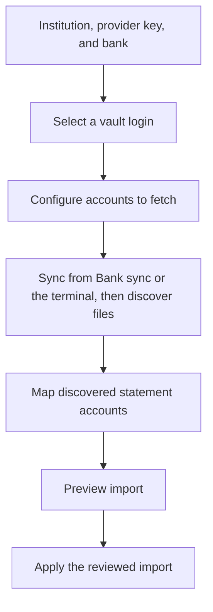

# Settings

## Purpose and design philosophy

Settings separate financial configuration from machine configuration and presentation.
The user should know where a decision lives and whether it can be undone. Sure inspires
the settings navigation, not a hosted account or subscription model.

## Configuration ownership

Machine settings live in `omsync.toml`, normally at `~/.config/omsync/omsync.toml`.
`OMSYNC_CONFIG` selects another file; `OMSYNC_*` values override machine settings.
The defaults supply the data directory, loopback host, port, and vault idle timeout. The
vault email can be configured so terminal operations need not ask for it every time.
Configuration cannot widen the loopback bind address. Secrets live in the
[keychain and vault](access.md), never in TOML.

Institutions, accounts, aliases, providers, categories, keywords, rules, contacts, and
account nicknames live in the database. Browser storage owns device presentation such as
theme, privacy mode, and accounts-panel geometry. Database presentation preferences own
shared choices such as joint share, dashboard layout, and whether a failed
sync closes its browser. These are not competing sources
of financial truth.

## Bank sync

Bank sync lists each institution by name and logo, with its providers and the accounts they fetch. A
[provider](sync.md#providers) is a bank login; an institution may have several, and each fetches
only its own accounts. A provider card shows its bank, its vault login by name while the vault is
unlocked, its latest sync, and its accounts. Open accounts that no provider fetches are listed under
their institution as not synced. Statement files for them still import from the institution's folder.
Logos are bundled files named for institution keys; a business variant such as `chase_business`
shares its personal institution's logo, and an institution without a file shows its initial. Sync
all and each card's Sync button start syncs from the page; see [syncing from the web](sync.md#syncing-from-the-web).

Editing a provider changes its vault login and the accounts it fetches. The account choices name
the provider that already fetches an account, and that account cannot be chosen twice. The bank is
read-only: to use another bank, delete the provider and add one. Deleting keeps the accounts,
transactions, statement files, and sync history, and only stops syncing. Both are
[batches](changes.md) that undo reverses, and both are refused while a sync holds the operation lock.

The add-provider wizard has five steps:

The first step accepts an existing institution key, which adds a provider to that institution and
keeps its name. A new key creates the institution with the display name. The provider key must be new
and defaults to the institution key. The provider key then travels in hidden fields, and the vault
login and accounts steps save for that provider. The drop folder is not offered as a bank. Several
institutions may use one connector when they share the same bank flow, each with its own vault
login, such as personal and joint Chase logins. Chase Business selects its distinct connector
because its authentication and download contract differ.

A new account made outside the wizard, in the mapping step or with `omsync accounts add`, joins its
institution's only provider. When the institution has several providers, the account stays unassigned
and shows as not synced until Edit provider chooses it.

Account mapping offers a new account, an alias for an existing account, or skip. A matching
last-four label can suggest an account but does not prove its identity, so only a sync links
one by itself, under the conditions in [sync](sync.md); otherwise the person confirms. Bank of America's
CSV folders use last four digits as statement account IDs. Import binds to the exact files
and proposed changes shown in the preview; changed evidence produces a new preview rather
than an unreviewed apply.

Full statement-account identifiers do not belong in HTML, URLs, or messages. Mapping uses
short-lived opaque tokens tied to the institution; forged, expired, or foreign tokens map
nothing. Public labels show only masked last four digits. Source files may contain full
identifiers and remain private data.

## Categories

The Categories page lives in Settings, under Transactions, rather than on the icon rail: the user
shapes categories and keywords once and revisits them occasionally, so they are configuration, not
daily work. It holds the category table, the keyword lists, rules, the payee tester, triage,
keyword import, and categorize; their behavior is in [categories](categories.md). The page keeps its
long-table layout inside Settings: from xl the tables scroll under their headers beside the
sub-nav. The old `/categories` address redirects to it.

## Guides

Settings opens with a Learn section, whose Guides page lists walkthroughs of the app in four
groups: start here, everyday work, planning, and peace of mind. Each guide is a page with an
"On this page" list, numbered steps, and a link into the page it describes. The guides are written
into the app's templates and listed in `web/guides.py`, which also holds each guide's title, read
time, and icon. They are documentation, not data, so they change no financial state and no batch.

Read marks are a presentation preference: the browser keeps the slugs of guides marked as read under
`omsync-guides-read` in local storage, so they are per browser and never shared. Without storage the
marks last for one visit. In demo mode `/settings` opens on Guides rather than Bank sync, because the
demo has no bank sync to set up. A guide's screenshots come from `static/img/guides` when the files
exist, and a labelled placeholder takes their place when they do not.

## Contacts and rental settings

The Contacts page holds the people and businesses on the other side of your money, and you (see
[contacts](contacts.md)). It lists every contact, you first, and each has a page of its own. Your
page has your names, saved in parts and recognized in the forms banks print, and your accounts
outside the ledger with the patterns tied to them. Each tracked account's nicknames, the names a
payment app shows for it, are edited on that account's page. Names and nicknames are literal
transfer-recognition alternatives, not hard-coded personal identities. The joint rule reads them too,
to tell your joint-account inflows from your partner's. `/settings/you` and `/settings/names` redirect
to your page.

Rental preferences map accounts to property labels and choose category names for
[workbooks](reports.md). Removing a property mapping changes reporting configuration,
not its transactions. Category choices outside the configured set appear as Other.

Institution, account, provider, contact, name, and nickname changes use [batches](changes.md).
Rental mappings/categories and ordinary presentation preferences save directly
without financial undo. The interface must not offer an undo promise for
settings that are not batches.

## Design rationale

The wizard validates each submitted step on the server. Hidden form values, including the
provider key, are input, not authority. Opaque mapping tokens let the user approve source identity without exposing
full account numbers to browser markup or allowing a forged ID to select another account.

Machine configuration describes where omsync runs. Database configuration describes what
it tracks. Keeping those distinct makes local operation, tests, and
[backup restoration](backups.md) predictable. `omsync doctor` reports missing setup without
starting an import or an external sync.
