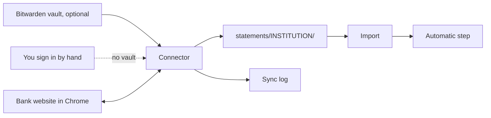
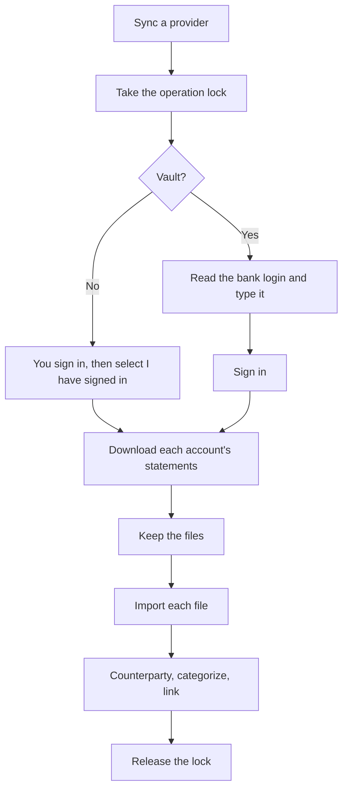
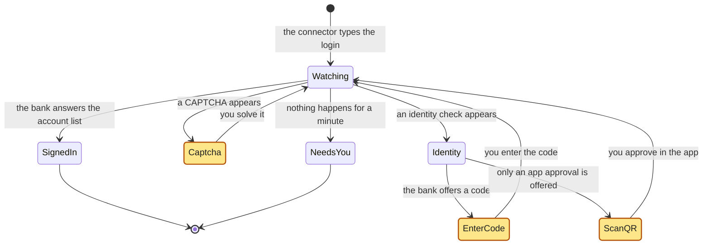

# Sync, providers, and connectors

## Purpose

Sync downloads the statement files that you could download by hand, then imports them. Download
and import are separate, so a bank's website change never changes import rules.

## Context

## Flow

### One sync

### Sign-in with a vault

## Design decisions

- **Sign-in is complete when the bank returns the account list.** omsync does not read the sign-in
  state from the page. A redesign cannot hide a sign-in or show a false one.
- **Without a vault, you tell omsync that you signed in.** omsync then asks the bank for the
  account list, as after a typed login.
- **Files are kept as the bank sent them.** omsync never converts or merges them, because merged
  files caused duplicates in maneko.
- **Each download overlaps the one before it.** Banks post some transactions late with an earlier
  date. Import joins the repeated rows.
- **A new statement number links automatically only when one account matches it.** Otherwise you
  choose the account.
- **Sync uses its own Chrome profile in the data directory**, not your usual profile. A debugging
  port on 127.0.0.1 is open while a sync runs.
- **Bank sync is tested on macOS with Google Chrome.** The code has paths for other systems, which
  are not tested.

## Terms

- **Provider:** one bank sign-in, its connector, and the accounts it fetches. One bank can have
  several providers.
- **Connector:** the scraper for one bank.
- **Sync all:** each enabled provider in turn. A failure does not stop the next one. Cancel does.

See [ADR 0002](../adr/0002-download-statements-instead-of-using-an-aggregator.md) for why omsync
scrapes. See [bank requests](bank-requests/README.md) for each bank's download requests.
