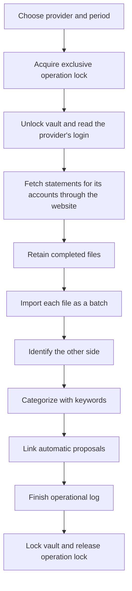

# Sync, providers, and connectors

## Purpose and design philosophy

Sync automates obtaining the same statement files that the user can supply by hand. Fetching
and interpreting statements are separate responsibilities, so a website change does not
require a different ledger or import policy.

A **provider** is how omsync fetches an institution's statements: a bank connector, the vault
login it uses, and the accounts it fetches. A **sync** runs one provider's connector, retains
its statement files, and imports them. The drop-folder connector supplies no browser
automation: the user places files in the institution folder and uses the same import path.

## Behavior

- A connector fetches for its provider's open accounts and returns the files it obtained.
  It never imports or changes transactions itself.
- Downloaded files retain the institution's contents. omsync does not convert them into
  another statement format or merge descriptions from a second download.
- Files are retained under `statements/<INSTITUTION>/` without overwriting previous files.
  Formats without an account ID use an account subfolder.
- Fetching is an external operation that writes files and an operational log. A sync always
  imports the files it fetched, each as its own batch under the [import contract](import.md).
- After importing, a sync [identifies the other side](contacts.md#running-it-automatically) and
  [categorizes](categories.md) the history with the keywords, then lets
  [reconciliation](reconciliation.md) link the proposals that need no review, as one batch that
  undo reverses, and the result says how many links it made. Sync all does this once per provider,
  since each provider's import is its own run and the next provider's files can complete a pair
  the previous one left open.
- Categorizing is its own batch that `omsync batches undo` reverses, and it can categorize earlier
  transactions that were left unset. A sync then identifies the other side and categorizes the
  provider's accounts once more, which changes nothing when that step succeeded. Keywords that
  cannot be applied, or a preview gone stale, fail the sync with a message but keep the imported
  statements, and `omsync categorize` categorizes later.
- Before importing, a sync links a statement account its files name to an account when the
  provider asked the institution for that account, exactly one open account at the institution
  ends in the same four digits, and that account has no statement alias yet. The link is an
  [alias batch](changes.md), and the result lists the digits linked. A reissued card, whose
  account already has an alias, and any other case is not linked by guess. The files stay
  pending, the result names the unlinked digits, and Bank sync offers the linking step so the
  person decides.
- A sync that fails, or skips an account, closes its browser by default. The Bank sync page has
  a Close Chrome when a sync fails checkbox, saved as a [preference](settings.md). Unticked, a
  failed sync leaves the browser open on the page it stopped on, so the person can look at it,
  and the next browser any sync starts closes it. A sync that succeeds always closes its browser.
- When the bank gives nothing usable for one account, the connector skips that account and
  fetches the others. The files it got are kept and imported, and the sync is reported as failed
  with the accounts that were skipped. A failure of the whole fetch keeps nothing.
- With no explicit range, sync overlaps recent history to obtain corrections as well as
  new transactions. Repeated rows rely on import identity, not a download cutoff, to avoid
  duplication. Import reads every row the institution actually returns.
- The terminal sync unlocks the [vault](access.md) through a secret prompt and locks it when
  finished. A sync started from the web uses the vault the page unlocked, which keeps its idle
  timeout. Multi-factor authentication asks the user for the institution's code, in the terminal
  or on the Bank sync page. A connector declares how many digits its code has when it is not 6, and
  the page sends the code once that many are entered. A CAPTCHA or incomplete verification returns control to the user
  rather than bypassing it.

## Providers

- An institution may have several providers, such as a personal and a joint login at one
  bank. Each fetches only the accounts it owns, into the institution's shared folder. An
  account has at most one provider, and an account's provider must be at its institution.
- Editing a provider's vault login and accounts, and deleting it, are batches that
  `omsync batches undo` reverses. Deleting removes the provider and its account links only.
  Accounts, transactions, statement files, and sync history stay.
- A provider's bank cannot be changed. To use another bank, delete the provider and add one.
- Editing or deleting is refused while a sync of any provider holds the operation lock, so a
  change never lands mid-sync.
- Sync all runs every enabled provider, one at a time, in institution and then provider key
  order. A provider that fails or cannot run does not stop the others, and each gets a result.

## Syncing from the web

The [Bank sync](settings.md#bank-sync) page starts syncs with Sync all or a provider card's Sync
button. Each start is a job that runs in a background thread of the server process, while the
page polls for its state and shows each provider's result when the job ends.

- One job runs at a time, and a start while one runs is refused. Jobs share the sync lock with
  the terminal, so a sync or a receipt download in a terminal makes a web job end as failed,
  with a message to try again when it finishes.
- A web sync always imports the files it fetched, as the terminal does, and Sync all keeps going
  after a failed provider.
- When a connector asks a question, such as for an MFA code, the question appears on the page.
  The sync waits ten minutes for an answer. Without one, the connector gives up and the provider
  ends as needing you, and syncing again asks again. An answer goes to the connector and is not
  kept or shown again.
- Chrome still opens a visible window for each bank, as it does from the terminal. Keep that
  window open until its sync finishes.
- Job state is held in memory, so a restarted server shows no earlier job. The sync log keeps
  every run's outcome.

## Flow and operational state

One sync or Costco receipt download drives the shared browser at a time. A competing
operation refuses rather than waiting invisibly. Archive creation and restore use the same
operation lock so they cannot race with downloaded files or sync imports.

The sync log records provider, institution, connector, start and finish, fetched-file count,
status, and a safe message. Status distinguishes running, succeeded, failed, and needs user action.
The log survives undo of an import because the external attempt really happened. Messages
never contain passwords, tokens, usernames, or full account numbers.

## Institution-specific design

| Connector | Source and consequential behavior |
|---|---|
| Bank of America | Checking/savings use date-range CSV. Credit cards offer statement-based CSV downloads, so the connector obtains the available statements rather than pretending the site offers the same custom range. CSV account folders identify the account. |
| Chase personal | QFX/OFX downloads use the personal verification interface. A purchase and its foreign transaction fee share one FITID, so [import](import.md) treats Chase FITIDs as untrusted. |
| Chase Business | QFX/OFX downloads use a distinct connector and business verification interface, which can ask for the password again. Its FITIDs are untrusted like Chase personal's. Business card requests include the eligibility declaration Chase requires. |
| Citi | OFX source files are retained. FITIDs can change between downloads; [import](import.md) treats them as untrusted. |
| Fidelity Rewards | The website supplies a single-account QFX download. The file's account ID determines its ledger account. |

Chase's download token is exposed by an activity-download request rather than ordinary
page markup. A preliminary download over a wider period obtains it; that preliminary file
is discarded. The requested activity, not the token-acquisition file, is retained. This
separates an institution authentication requirement from the user's import period. Each
account's download repeats the site's own request, at its host and with its parameters and
script-set headers, changing only the account and dates, so a site that moves its download or
adds a requirement is followed rather than guessed. Nothing captured outlives the sync, because a
stale token would hide a failed capture. Personal and business behavior is selected explicitly by
the provider's connector; it is never inferred from an MFA page that Chase may skip.

Institution pages often identify accounts by the last four digits. Connectors can use
those labels to locate configured accounts, but ledger identity still comes from account
aliases. An account without either usable last four digits or a statement alias is refused.

## Browser and safety rationale

Chrome uses omsync's dedicated browser profile and loopback-only remote debugging. The
first URI in the selected Bitwarden item determines where the connector types credentials;
an HTTP(S) address is required, with a built-in institution address used when no URI exists.
The user must select a trustworthy vault item and sign-in address. Logs omit URL credentials,
queries, and fragments.

Browser cookies and profiles contain sensitive sessions and stay outside the repository.
Changes to institution automation require live validation at that institution: fixtures
can establish local behavior but cannot prove what an external website accepts. Selectors,
request construction, and private browser interfaces belong in code, not this document.
