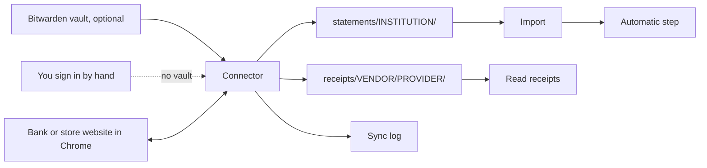
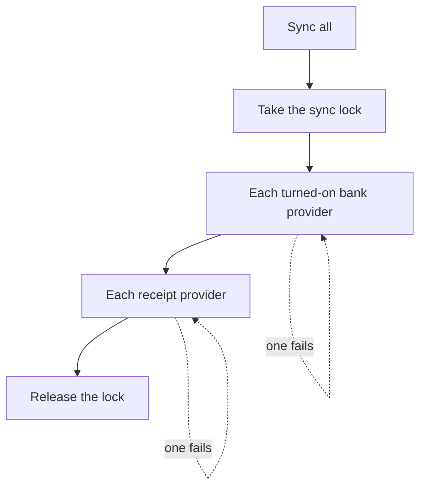
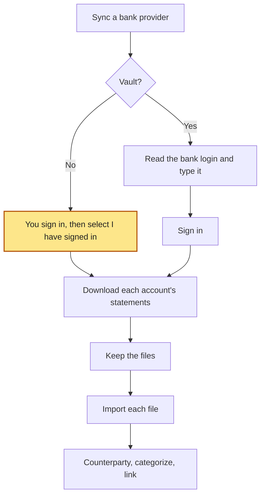
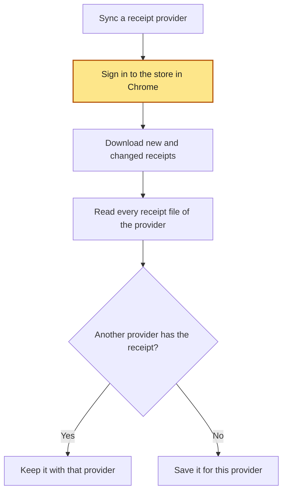
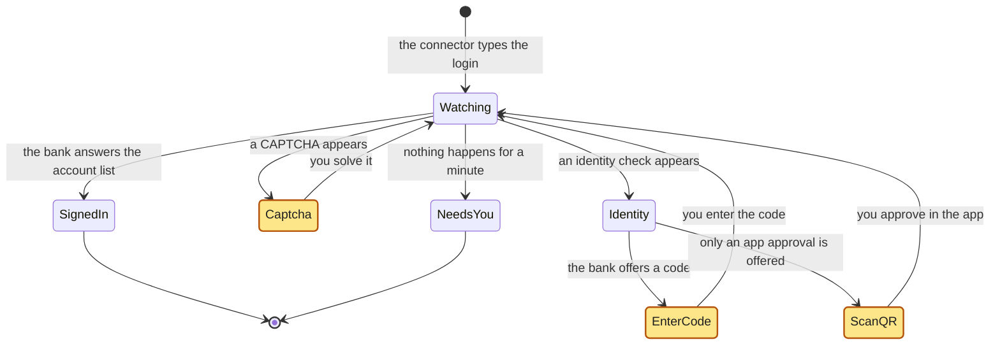

# Sync, providers, and connectors

## Purpose

Sync downloads the files that you could download by hand. A bank provider downloads statement
files, and omsync then imports them. A receipt provider downloads receipt files, and omsync then
reads them. Download and import are separate, so a website change never changes import rules.

## Context

## Flow

### Sync all

The page and the `omsync sync --all` command use the same sync. A failure stops only its provider.
Cancel stops the providers that did not start.

### One bank sync

### One receipt sync

### Sign-in with a vault

## Design decisions

- **One sync runs at a time on this computer.** Sync all holds the sync lock from the first
  provider to the last. A sync from the terminal cannot start between two providers.
- **Banks and stores follow the same provider rules.** Both kinds have one key space. Add, edit, and
  delete are batches, and you can undo them. omsync refuses an edit or a delete while a sync runs.
- **Deleting a provider keeps your data.** Accounts, transactions, statement files, and receipt
  files stay. omsync deletes the sync log of the provider and its receipt rows. A new sync reads
  the receipt files again.
- **Sign-in is complete when the bank returns the account list.** omsync does not read the sign-in
  state from the page. A redesign cannot hide a sign-in or show a false one.
- **Without a vault, you tell omsync that you signed in.** omsync then asks the bank for the
  account list, as after a typed login.
- **Files are kept as the bank sent them.** omsync never converts or merges them, because merged
  files caused duplicates in maneko.
- **Each download overlaps the one before it.** Banks post some transactions late with an earlier
  date. Import joins the repeated rows. A receipt sync starts 14 days before the newest receipt.
- **A new statement number links automatically only when one account matches it.** Otherwise you
  choose the account.
- **Sync uses its own Chrome profile in the data directory**, not your usual profile. A debugging
  port on 127.0.0.1 is open while a sync runs.
- **Bank sync is tested on macOS with Google Chrome.** The code has paths for other systems, which
  are not tested.

## Terms

- **Provider:** one sign-in and its connector. A bank provider fetches statements for its accounts.
  One bank can have several providers. A receipt provider fetches the receipts of one store login.
- **Connector:** the scraper for one bank or one store.
- **Sync all:** each turned-on bank provider in turn, then each receipt provider.
- **Sync log:** the start, the end, the status, and the file or receipt count of each provider sync.

See [ADR 0002](../adr/0002-download-statements-instead-of-using-an-aggregator.md) for why omsync
scrapes. See [bank requests](bank-requests/README.md) and
[vendor requests](vendor-requests/README.md) for the download requests.
