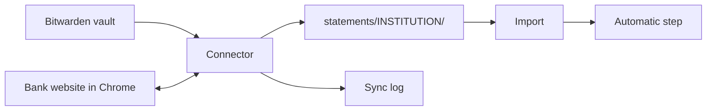
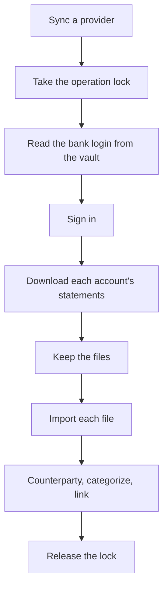
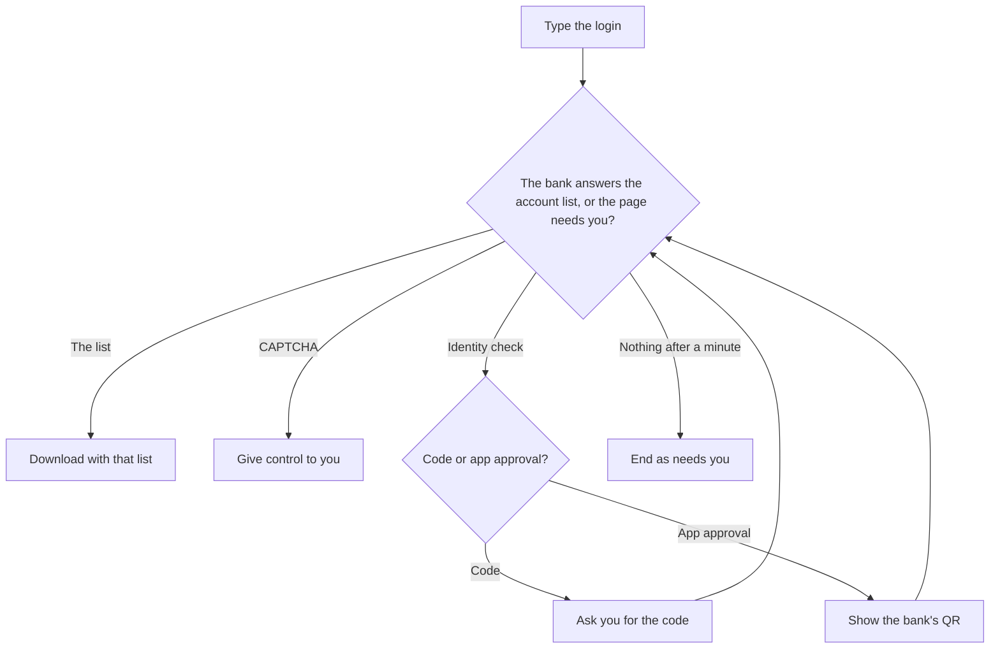

# Sync, providers, and connectors

## Purpose

Sync downloads the statement files that you could download by hand, then imports them. Download
and import are separate, so a bank's website change never changes import rules.

## Context

## Flow

### One sync

### Sign-in

## Design decisions

- **Signed in means the bank answers the account list.** omsync never reads this from the page. A
  redesign cannot fake or hide a sign-in.
- **Files stay as the bank sent them.** omsync never converts or merges them.
- **One bad account does not stop the sync.** omsync skips it, keeps the other files, and reports
  the sync as failed.
- **A failed sync leaves Chrome open.** You can see the page where it stopped.
- **Each sync overlaps recent history.** It gets corrections. Import identity stops duplicates.
- **A new statement number never links by guess.** omsync links it only to one clear account.
  Otherwise you decide.
- **Chase takes a code before an app approval.** A code has passed live tests the longest.
- **The provider sets Chase personal or Business.** omsync never guesses it from the page, because
  Chase can skip the page.
- **One sync at a time.** Sync, receipt downloads, backup, and restore share one lock. A second
  operation is refused, not queued.
- **Logs hold no secrets.** No passwords, tokens, usernames, or full account numbers.
- **Each scraper change needs a live test at the bank.** Fixtures cannot prove what a website
  accepts.

## Terms

- **Provider:** one bank login, its connector, and the accounts it fetches. One bank can have
  several providers.
- **Connector:** the scraper for one bank.
- **Sync all:** each enabled provider in turn. A failure does not stop the next one. Cancel does.

See [ADR 0002](../adr/0002-download-statements-instead-of-using-an-aggregator.md) for why omsync
scrapes. See [bank requests](bank-requests/README.md) for each bank's download requests.
