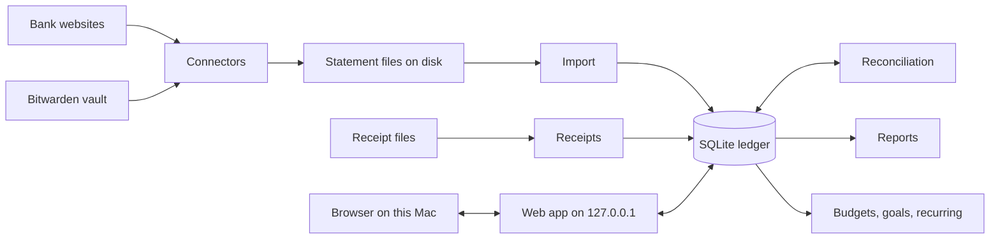
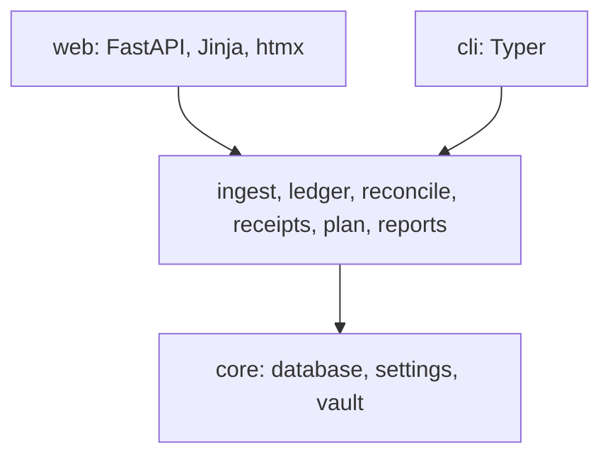
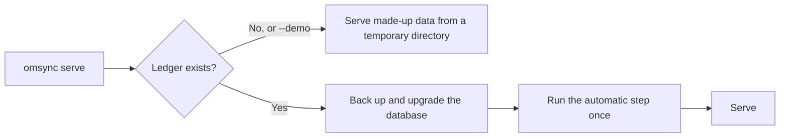

# System

## Purpose

omsync is a personal finance tracker for one person on one Mac. It turns bank statements into a
ledger, explains spending with receipts, links related transactions, and shows reports, budgets,
and goals.

## Context

## Flow

### Code layers

Dependencies point down. A domain package never imports the web or CLI layer.

### Server start

## Design decisions

- **Trust before convenience.** Import keeps the evidence. Automation never replaces your
  decisions. A change is clear before it applies. An uncertain match stays uncertain.
- **Local only.** The server listens only on `127.0.0.1`. No setting changes that.
- **Local still needs sign-in.** A website in your browser can reach a local server. Sign-in,
  origin checks, and strict cookies stop that.
- **Statements are the source.** You do not type transactions in. Each format is one bank's
  format, not a general CSV mapper.
- **The server owns the rules.** JavaScript improves the page. It never repeats a financial rule.
- **One currency, integer cents.** omsync tracks money movement, not investments or net worth.
- **Your data stays out of the repository.** Tests and the demo use made-up data.

## Terms

- **Data directory:** the database, statements, receipts, browser profile, and backups. The
  default is `~/omsync-data`.
- **Automatic step:** identify counterparties, categorize, and apply automatic links. It runs
  after each import, after each sync, and at server start.
- **Demo:** made-up data in a temporary directory. It never touches the data directory.

See [ADR 0001](../adr/0001-build-omsync-instead-of-using-sure.md) for why omsync exists.
