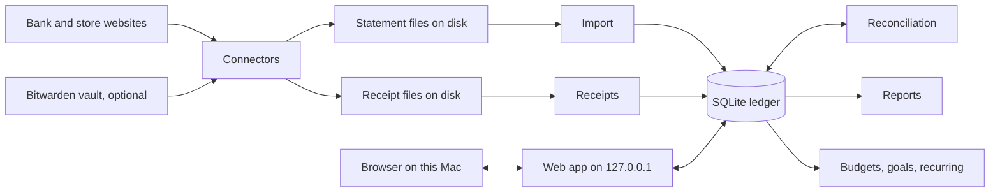
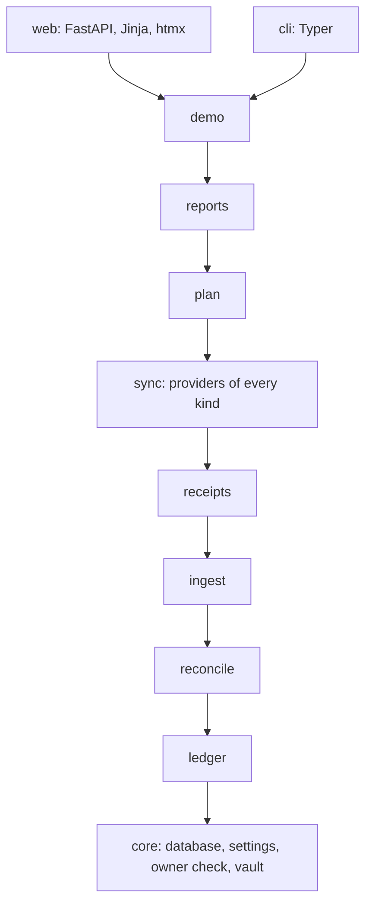
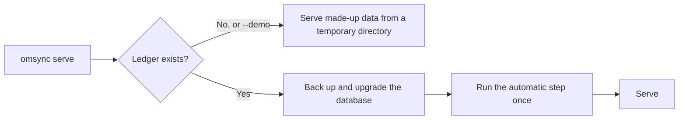

# System

## Purpose

omsync is a personal finance tracker for one person on one Mac. It turns bank statements into a
ledger, explains spending with receipts, links related transactions, and shows reports, budgets,
and goals.

## Context

## Flow

### Code layers

Each package imports only the packages below it. The import check enforces this.

### Server start

## Design decisions

- **The server listens on 127.0.0.1 only.** Sign-in is still necessary, because a website in your
  browser can send requests to the server. See [access](access.md).
- **Code that bank sync and receipt sync share is in `sync`.** Bank sync in `ingest` and receipt
  sync in `receipts` each do one kind. Only `sync` chooses the kind of a provider.
- **Transactions come only from statement files.** Each format reads the files of one bank. There is
  no manual entry and no general CSV mapper.
- **Financial rules run only on the server.** JavaScript moves focus, opens dialogs, and draws
  charts.
- **omsync records money movement in one currency.** It does not track investments or net worth.

## Terms

- **Data directory:** the database, statements, receipts, browser profile, and backups. The
  default is `~/omsync-data`.
- **Automatic step:** identify counterparties, categorize, and apply automatic links. It runs
  after each import, after each sync, and at server start.
- **Demo:** made-up data in a temporary directory. It never touches the data directory.

See [ADR 0001](../adr/0001-build-omsync-instead-of-using-sure.md) for why omsync exists.
