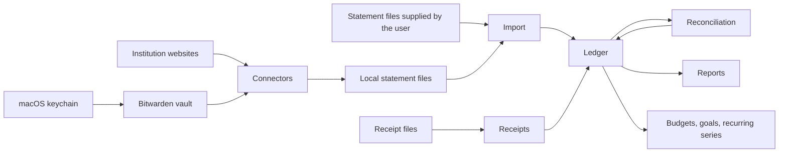

# System

## Purpose and design philosophy

omsync is a local, single-user personal finance tracker for a Mac. It turns institution
statements into a durable ledger, uses receipts to explain spending, links related money
movements, and supports reports, budgets, and goals.

The organizing principle is **trust before convenience**. Import must preserve evidence;
automation must protect the user's decisions; totals must conserve money; and a proposed
change must be understandable before it is applied. An uncertain explanation stays
uncertain rather than becoming a confident-looking fact.

The main routine is to obtain statements, review import decisions, and categorize spending.
Reconciliation is a separate, less frequent review of relationships between transactions.
Neither routine depends on finishing the other before the ledger is usable.

## Behavior

- One person uses one local installation. A partner may share financial accounts but does
  not have an omsync login.
- The web server binds only to `127.0.0.1`. Configuration cannot expose it to another device.
- The ledger uses one currency and exact integer cents. It tracks money movements, not
  investment performance, asset valuations, or net worth.
- Transactions come from statement files, not manual transaction entry. Supported formats
  are explicit institution formats, not an arbitrary CSV-mapping interface.
- Personal data stays outside the repository. Tests and development use synthetic data
  in disposable directories, never the user's data directory, home, or keychain. The demo that
  `omsync serve` shows without a ledger is synthetic data built in a temporary directory, and
  it never touches the user's data directory either (see [access](access.md#demo-mode)).
- Imports, categorization, receipt application, and reconciliation use the shared
  [change contract](changes.md). Fetching external files is separate from ledger writes.

## System boundaries

The data directory contains the database, statement files, receipts, browser profile,
backups, and generated exports. The default location is `~/omsync-data`; machine
configuration can choose another location. Secrets are not machine configuration.

## Technical design

The application is a server-rendered Python application: FastAPI, Jinja, htmx, SQLAlchemy,
Alembic, and SQLite. uv manages Python dependencies. Tailwind builds the styles; focused
JavaScript controllers handle browser interaction and charts. There is no separate client
application or independent client-side ledger.

Dependencies point from the web and CLI entry points into domain packages, then into shared
core services. Domain packages never import the web layer. Web and CLI operations share
domain behavior instead of maintaining separate financial implementations.

`omsync serve` upgrades the database, then runs the [automatic step](contacts.md#running-it-automatically)
that follows an import once before it serves, so a failure there is logged and never blocks
startup. With no ledger at the configured path, or with `--demo`, it serves the demo instead:
a copy of made-up data in a temporary directory, which is deleted when the server stops.

SQLite is the authority for ledger state. Source files retain the institution or vendor's
evidence. Browser storage holds presentation preferences, not financial truth. External
sessions and files are outside database undo.

## Design rationale

Local operation reduces the security surface and keeps the user's financial data under
their control. It does not make authentication or cross-origin protection unnecessary:
a browser can reach a loopback service while visiting another site.

Server-rendered interaction keeps financial validation and writes in one place. JavaScript
improves navigation and presentation without becoming a second implementation of the
product's rules. The concrete stack and private interfaces are expressed in code; these
docs explain the boundaries those interfaces must preserve.

Feature specs define intended behavior. Code and tests must follow them. A behavior change
updates its authoritative spec in the same change; other documents link to that authority
rather than repeating it.
