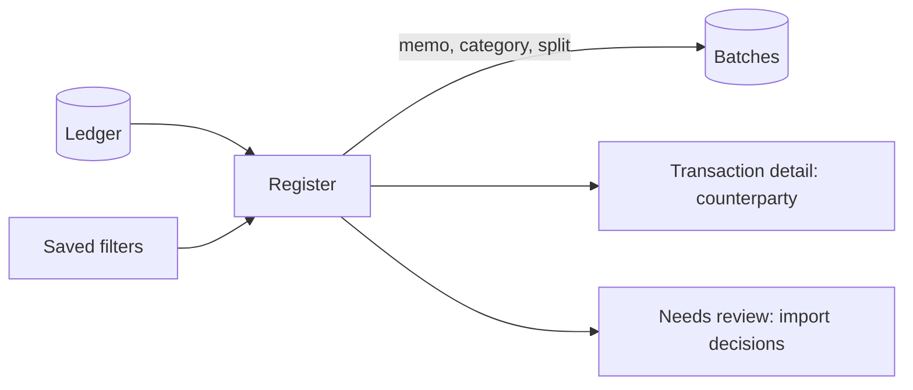
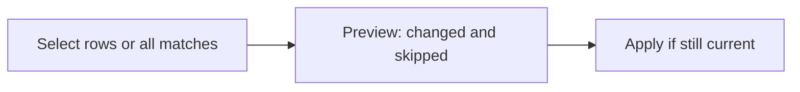

# Transactions

## Purpose

The register shows the ledger as rows. You edit transactions there, one at a time or in bulk.

## Context

## Flow

### Bulk change

## Design decisions

- **Only category, memo, counterparty, and splits are editable.** Date, account, and amount come
  from the statement.

## Terms

- **Needs review:** import rows that may be a known transaction. You pick one or add a new one.
- **Saved filter:** a named set of conditions.
- **Category is empty:** no category, or a split that has no category.
