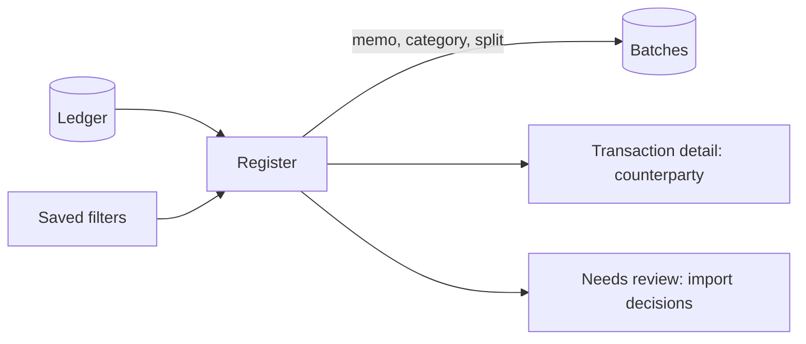
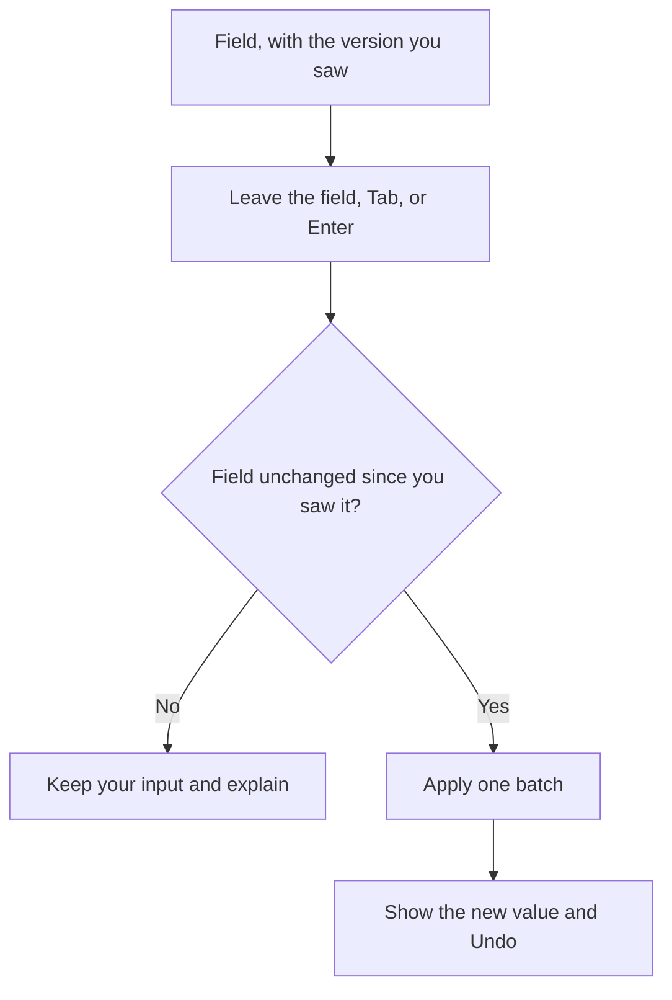
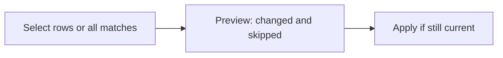

# Transactions

## Purpose

The register is where you read and edit the ledger: fast keyboard edits, visible splits, and bulk
changes that you can undo.

## Context

## Flow

### Edit one field

### Bulk change

## Design decisions

- **You edit meaning, not money.** Date, account, and amount come from statements. They are not
  editable. This keeps the balance check true.
- **Cells are always fields.** No edit mode. This follows the keyboard-first register in other
  budget apps.
- **Category is a select, not free text.** It sends the category itself. A name is never guessed.
- **A split is a separate action.** Typing in a row never creates a split.
- **Splits add up exactly.** Removing splits leaves the transaction uncategorized.
- **Your edits are manual origin.** Automation never replaces them.
- **One field's conflict refuses only that field.** A change to another field in the row does not
  block it.
- **The server checks every save.** The page only moves focus and shows results.
- **The page shows one page of rows.** The browser never loads the whole ledger. The page and the
  filter are in the URL.

## Terms

- **Needs review:** import rows that may be a known transaction. You pick one or add a new one.
- **Saved filter:** a named set of conditions.
- **Category is empty:** no category, or a split with an uncategorized line.
