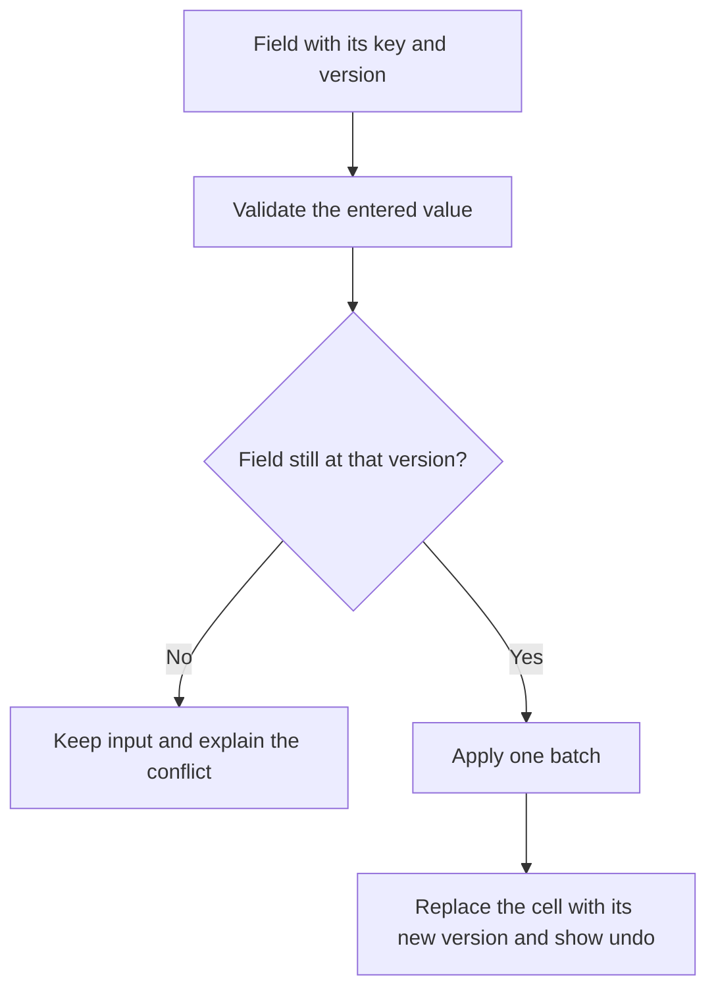

# Transactions

## Purpose and design philosophy

The register is the working surface for understanding the ledger. It emphasizes fast
keyboard editing, visible splits, and reversible bulk work. Actual Budget's register
inspires the interaction model; the financial contract follows omsync's
[ledger](ledger.md) and [change](changes.md) design.

## Behavior

Transactions appear newest first, with account, date, payee, memo, category, and signed
amount. An account view scopes the register to that account. Split transactions show the
parent and its categorized parts without presenting the parts as independent transactions.

The register shows one page of rows at a time, so it never loads the entire ledger into the
browser. A pager under the table shows which rows are on screen out of how many match, the rows
per page (25, 50, 100, or 200, saved as a preference), and Prev and Next. The page is in the URL
with the filter, so reload and Back keep the place; a page past the last is the last. A new filter
or search starts again at page 1, and a new page size keeps the first row on screen. Paging is by
position, so editing rows under a filter such as uncategorized can move later rows between pages.

Memo is an always-visible input and category an always-visible select, as the name and type on
the Categories page are. Leaving the memo, Tab, or Enter saves it, and Escape restores the saved
value. Category lists Uncategorized and every visible category by name. A choice made with the
pointer saves at once. A choice made with the keyboard, including type-ahead, saves when the
field is left, so stepping through options is one change. The payee is shown as stored and is not
edited in the register. The memo column is 350px when the register is wide enough for every column
at that width; on a narrower register it gives up room first, so category and amount stay in view.
The payee column takes the remaining width and clamps to two lines, with the full payee as a
tooltip. On a phone the register scrolls sideways and the payee stays at its left edge, so the row
being edited is always named. A user category has manual
origin; clearing it returns the transaction to unset. A split's category is read-only, because its
lines hold the categories. Split transactions are classified through their splits rather than a
second parent category. Hidden or unknown categories cannot be assigned through ordinary pickers,
but a transaction that already has a hidden category still shows it.

Title and the All and Needs review tabs share one row. Search, the add-filter menu, the
condition chips, the match toggle, Clear filters, and the saved-filter menu share a second row,
which the bulk action bar replaces while rows are selected. A condition opens in a popover under
the chip or menu that asked for it. On large screens the title and these controls stay in view
while the table scrolls under them with its header row fixed and the pager below it; on small
screens the whole page scrolls.

The split editor shows the amount left. Each part has a category and a nonzero amount, which may
be positive or negative. Save requires exact conservation of the parent amount. User splits
have manual origin and clear the parent category. Removing the splits leaves the transaction
uncategorized rather than inventing a replacement category.

Tab and Shift+Tab move between the fields of a row, and leaving a field saves it. Enter saves and
moves down to the same field of the next row. Up and Down arrows move between rows, except in a
category list that is open, where they choose an option. Letters always type into the focused field
or jump within the category list; a split opens only from the row's Split button. A refused save
keeps the entered value and says why, and navigation does not treat a failed save as success.

## Transaction detail

A transaction's detail page, opened from the row's actions menu, shows the transaction and who is on
the other side of it: the contact and the contact's account, or one of the owner's accounts outside
the ledger, and whether omsync recognized it or you set it (see [contacts](contacts.md)). It sets the
other side to a contact or account, or clears it, as a batch with the usual undo. A split transaction
lists its parts, each with an other side of its own that the transaction's other side stands in for
when empty. The register itself does not edit the other side.

The detail also says which rule set the transaction's category, as "Set by rule" with the rule's
sentence. A transaction whose category a rule set, but that no rule holds for now, says so instead.

## Edit flow

Every save carries an idempotency key and the version of the field the person saw. A retry applies
once; a change to that field made elsewhere causes refusal instead of overwriting it. Changes to
other fields in the row do not refuse it. Undo follows the shared change contract.

## Finding and changing groups

Search covers display payee, raw payee, and memo. Filters combine account, date, payee,
category, amount, memo, and category origin with all/any semantics. Date and amount ranges
include their endpoints; signed amounts retain their ledger meaning.

A category filter matches a parent category or any split category. Its negation is the
negation of that whole condition, including uncategorized transactions. "Category is empty"
matches uncategorized transactions: an unsplit transaction with no category, or a split one with
any line that has none, as a receipt leaves an item that matched no keyword. Filters and account
scope are represented in the URL so reload and browser history preserve the selection.
An unreadable filter is rejected with a usable explanation, not silently interpreted as
another query.

Saved filters have unique names and can be created, updated, and deleted as batches.
Selection supports individual rows, ranges, the current page, or every matching transaction.
Bulk category and memo edits preview the affected and skipped counts before apply. Category
changes skip split transactions; memo changes can include them. The preview must still be
current at apply time.

The Needs review view displays unresolved [import](import.md) evidence and the transactions
a row might describe. The user chooses an existing transaction or adds a new one. This
resolves source identity; it is distinct from receipt triage or reconciliation review.

## Design rationale

A register edits interpretation, not source money: dates, accounts, and amounts are not
ordinary inline edits. Keeping those values tied to statements makes balance checking
meaningful and avoids an accidental second source of transaction truth.

Cells are always fields, as in Actual Budget's register and the Categories page, so a field needs no
mode switch before it takes an edit. Category is a select rather than text with suggestions, because
suggestions filter by what the field already holds, so a categorized row could not be switched
without first clearing it; a select also sends the category itself, so no name is interpreted.
Splitting is a separate deliberate action, so typing in a row can never create one. Partial HTML updates and explicit focus restoration make keyboard editing
practical while the server remains the validation authority. User choices become manual-origin data so
later categorization or receipts cannot undo them by automation.
