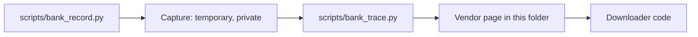
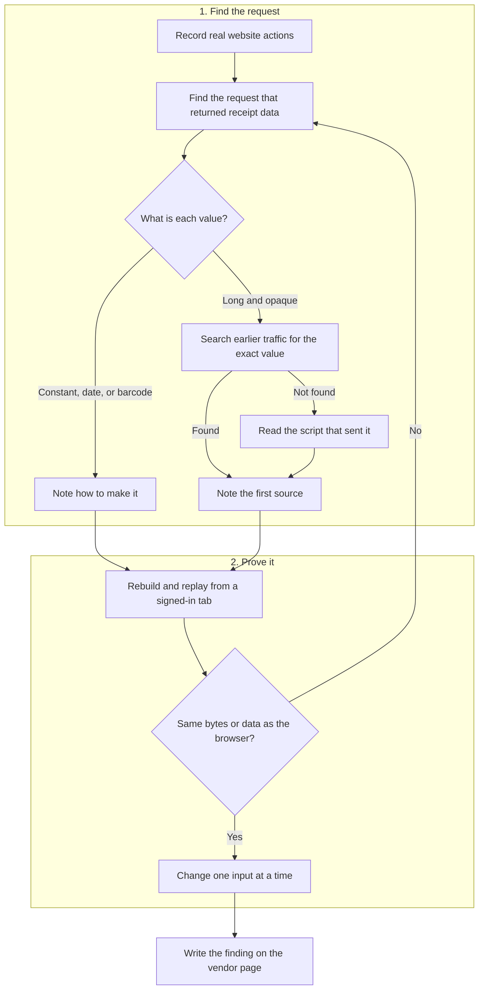

# Reconstructing vendor requests

## Purpose

A downloader sends the request that the vendor website sends. A direct request survives a page
redesign. This page shows how to find that request and prove that it works. Each vendor page gives
the date of its last live test.

## Context

| Vendor | Token the download needs | Where it comes from |
|---|---|---|
| [Amazon](amazon.md) | `x-amzn-upx-token` | Page props (`__NEXT_DATA__`) on transactions page |
| [Costco](costco.md) | Bearer token (`idToken`) and `clientID` | Browser local storage |

## Flow

## Design decisions

- **Run requests inside the authenticated tab.** Protection scripts such as Kasada or AWS WAF attach headers
  and cookies to requests that start from the page. Direct requests from outside the browser fail.
- **Find a value by its content, not its name.** Names change between site releases. Search local
  storage, session storage, and page scripts for the value itself.
- **Keep secrets out of captures.** Use a temporary browser profile. Do not save sign-in bodies.
  Print names and lengths, not values. Delete the capture after use.

## Terms

- **Capture:** a recording of website traffic, cookies, and storage.
- **Replay:** the rebuilt request sent from a signed-in tab.
- **Receipt summary:** the list of purchase headers with identifiers.
- **Receipt detail:** the complete receipt lines, item codes, and tender details.
