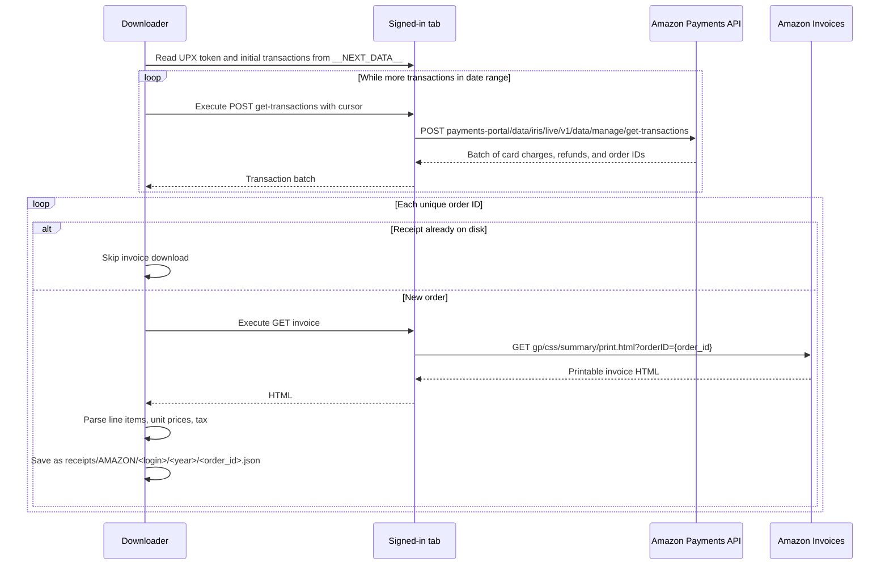

# Amazon requests

## Purpose

Amazon order and refund receipts come from Amazon's Iris payments API and printable invoice pages.
The API needs an authenticated session and an `x-amzn-upx-token` from the page state. Last validated
live: 2026-11-17.

## Context

Amazon protects payments and transactions with AWS WAF and session authentication. Requests must
run inside a signed-in tab on `www.amazon.com`, so browser session cookies and bot-protection tokens
apply automatically.

| State | Storage and address |
|---|---|
| Signed in | Address is `amazon.com/cpe/yourpayments/transactions`. `window.__NEXT_DATA__` holds `token` (`x-amzn-upx-token`) and `transactionList`. |
| Signed out | The browser redirects to `amazon.com/ap/signin`. `token` is absent. |

## Flow

## Design decisions

- **Read orders only from the payment history, not from the data export.** The data export did
  not give the card charge of each shipment or the gift card amount. The payment history gives each
  card charge. See [ADR 0003](../../adr/0003-read-amazon-orders-from-the-payment-history.md).
- **Discrete, atomic files per order.** Receipts save to
  `receipts/AMAZON/<login>/<year>/<order_id>.json`.
- **Skip orders already on disk.** The downloader does not write an order again when it has no new
  charge or refund. An order on disk keeps its items, so it needs no invoice request.
- **Send requests from the page.** `fetch` in `execute_async_script` inherits the browser's TLS
  fingerprint, AWS WAF cookies, and session cookies. Direct requests from outside the browser
  fail with HTTP 403 Forbidden.
- **Exact card charges make split-charge searches rare.** The `get-transactions` API gives each
  card charge, the last four digits of its card, and each refund with its order ID. omsync
  searches for transactions that add up to the total only when no transaction has a stated charge.

## Terms

- **x-amzn-upx-token:** security token embedded in the page state, required by the payments portal API.
- **orderData:** list of order display strings (`Order #...`) returned on each payment or refund transaction.
- **printable invoice:** printer-friendly HTML summary providing item titles, unit prices, and tax breakdown.
