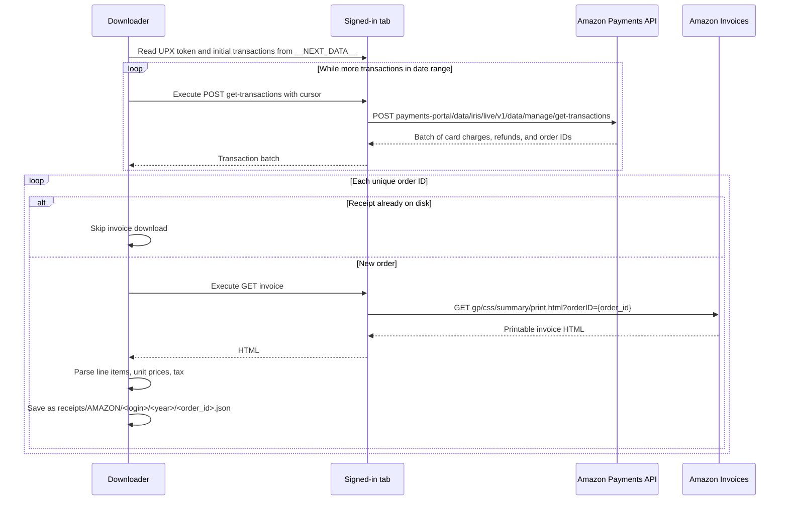

# Amazon requests

## Purpose

Amazon order and refund receipts come from Amazon's Iris payments API and printable invoice pages.
The API needs an authenticated session and an `x-amzn-upx-token` from the page state. Last validated
live: 2026-11-17.

## Context

Amazon protects payments and transactions with AWS WAF and session authentication. Requests must
run inside a signed-in tab on `www.amazon.com`, so browser session cookies and bot-protection tokens
apply automatically.

| State | Storage and address |
|---|---|
| Signed in | Address is `amazon.com/cpe/yourpayments/transactions`. `window.__NEXT_DATA__` holds `token` (`x-amzn-upx-token`) and `transactionList`. |
| Signed out | The browser redirects to `amazon.com/ap/signin`. `token` is absent. |

## Flow

## Design decisions

- **Replace the old manual CSV exports with native JSON receipts.** The old method required manual
  privacy data exports (`Order History.csv` and `Refund Details.csv`). The CSV export lacked card
  identities for split shipments and forced combinatorial guessing (`infer_charges`). The new flow
  records exact observed card charges and line items directly from the authenticated session.
- **Discrete, atomic files per order.** Receipts save to
  `receipts/AMAZON/<login>/<year>/<order_id>.json`.
- **Skip orders already on disk.** The downloader checks if `<order_id>.json` exists before
  requesting the printable invoice. Existing receipts require no invoice network traffic.
- **Send requests from the page.** `fetch` in `execute_async_script` inherits the browser's TLS
  fingerprint, AWS WAF cookies, and session cookies. Direct requests from outside the browser
  fail with HTTP 403 Forbidden.
- **Exact card charges eliminate split-charge guessing.** The `get-transactions` API explicitly
  provides each separate card charge, card last 4 digits, and refund tied to the order ID.

## Terms

- **x-amzn-upx-token:** security token embedded in the page state, required by the payments portal API.
- **orderData:** list of order display strings (`Order #...`) returned on each payment or refund transaction.
- **printable invoice:** printer-friendly HTML summary providing item titles, unit prices, and tax breakdown.
