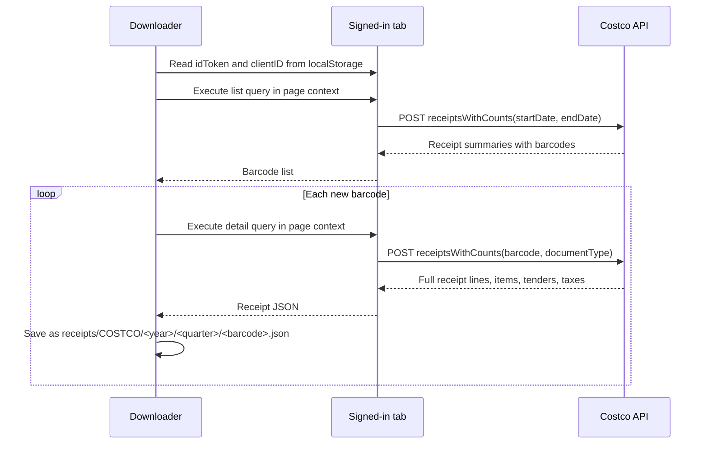

# Costco requests

## Purpose

Costco warehouse receipts come from Costco's order GraphQL API. The API needs a bearer token and
a client ID from browser local storage. Last validated live: 2026-11-17. Not tested live: gas
station and car wash receipts.

## Context

Costco protects the order API with Kasada bot mitigation. Requests must run inside a signed-in tab
on `www.costco.com`, so browser session cookies and bot-protection headers apply automatically.

| State | Storage and address |
|---|---|
| Signed in | `localStorage` holds `idToken` and `clientID`. The address contains `costco.com/myaccount`. |
| Signed out | The browser redirects to `signin.costco.com` or `LogonForm`. `idToken` is absent. |

## Flow

## Design decisions

- **Two requests per new receipt.** The summary query returns barcodes and totals for a date range
  without item descriptions. The detail query returns full line items for one barcode.
- **Skip receipts already on disk.** The downloader checks `<barcode>.json` before sending the
  detail query. Existing receipts require no network traffic.
- **Send requests from the page.** XHR in `execute_async_script` inherits the origin, session
  cookies, and Kasada SDK telemetry (`x-kpsdk-*`).
- **Dates format as M/DD/YYYY.** The query variables require single-digit months without leading
  zeros, and two-digit days.
- **Quarterly chunks.** Date ranges split into three-month chunks to avoid server query limits.

## Terms

- **transactionBarcode:** the unique identifier of a warehouse receipt, used as the file stem.
- **itemIdentifier:** Costco's one-letter product classification, such as E for food.
- **tenderArray:** payment methods recorded on the receipt.
